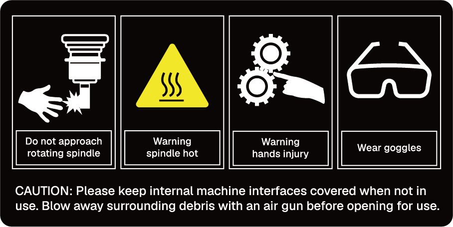
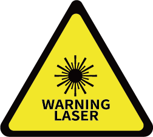
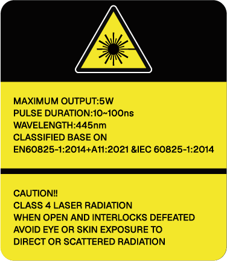
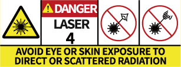
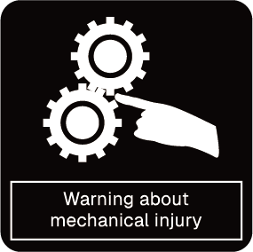
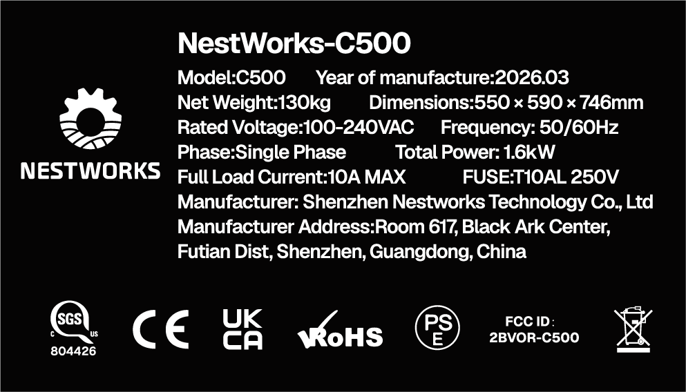

## Safety Symbols and Labels

Keep safety labels intact and clear. If labels are damaged, faded, or missing, contact your dealer immediately.  
All safety labels of the machine are permanent warning components. The user shall not tear off, cover, or alter them.

**Table 2-1 Safety Symbols and Labels** <!-- mdwb:table id=36f712d2397580d3 -->

| Safety Labels                                                                                            | Location               | Description                                                                                                                                                                                                                       |
| -------------------------------------------------------------------------------------------------------- | ---------------------- | --------------------------------------------------------------------------------------------------------------------------------------------------------------------------------------------------------------------------------- |
| <!-- publication-image: {width=3cm} --> | On the Spindle cover   | From left to right: keep hands away from the spindle; beware of high spindle temperature; keep hands away from moving parts; wear protective goggles during milling, and wear laser safety goggles when using the laser function. |
| <!-- publication-image: {width=3cm} -->                | NestPad Accessory      | Class I equipment; Class 4 laser product. Avoid eye or skin exposure to direct or scattered laser radiation.                                                                                                                      |
| <!-- publication-image: {width=3cm} -->   | On the machining cover | External laser warning label.                                                                                                                                                                                                     |
| <!-- publication-image: {width=3cm} -->         | On the machining cover | Laser identification and parameters.                                                                                                                                                                                              |
| <!-- publication-image: {width=3cm} -->      | Laser Module Cover     | From left to right: laser warning label; Class 4 laser product; avoid eye or skin exposure to direct or scattered laser radiation.                                                                                                |
| <!-- publication-image: {width=3cm} -->           | Chip Outlet            | Pinch hazard warning label.                                                                                                                                                                                                       |
| <!-- publication-image: {width=3cm} -->           | On the 4th-Axis        | Keep hands away from the fourth axis.                                                                                                                                                                                             |
| <!-- publication-image: {width=3cm} -->           | On the Machine Vise    | Keep hands away from the machine vise.                                                                                                                                                                                            |
| <!-- publication-image: {width=3cm} -->           | Near the Power Inlet   | Provides machine identification and certification information.                                                                                                                                                                    |

