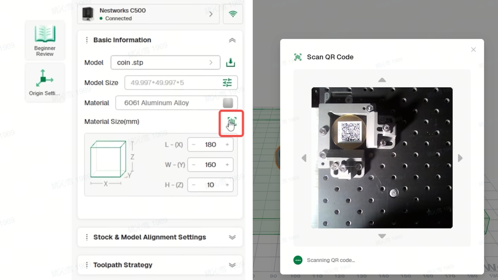

## Making a Brass Commemorative Coin

In this project, the C500 is used to machine a double-sided brass commemorative coin from a blank measuring Φ50 × 5 mm.

This project follows the same three-axis, double-sided machining workflow as the wooden digital clock project. This tutorial focuses on the material, tools, workholding method, and project settings specific to the brass commemorative coin. Common operations, including machine connection, tool data reading, automatic centering, toolpath generation, and back-side machining, are not covered again.

## Materials and Tools

Prepare the materials and tools shown below.

**picture position**

## Machining Workflow
### Workpiece Clamping
1. Install the fixture board and insert the two dowel pins, then install the L-shaped bracket.
2. Position the Φ50 × 5 mm brass workpiece blank in the designated location. Install and tighten the two OK clamps, ensuring the blank is securely held.

### Tool Setup
1. Install the 3 mm 3-flute flat end mill, 3 mm 2-flute ball-nose end mill, and V-bit in the tool magazine.
2. Check the tool information in Tool Management and confirm that the software records match the tools installed in the magazine.
### Machining Setup
1. Select the **3-Axis** machining mode and import the commemorative coin model. Click the **Smart Material Recognition** icon on the right, then scan the QR code to automatically populate the workpiece parameters.

2. Go to **Custom**, select the three cutting tools used in this project, then generate and preview the toolpaths for the front side.

4. Add **Flip Setting**, select the cutting tools required for machining the back side, then generate and preview the toolpaths for the back side.

### Start Machining
1. Select the front-side toolpaths and start machining.
2. Once front-side machining is complete, remove any surface chips. Flip the coin over and secure it again, making sure to follow the flip direction specified in the previous settings.
3. Remove the coin and clear any chips from its surface and engraved details. Finish the edges and remove any burrs as needed.
