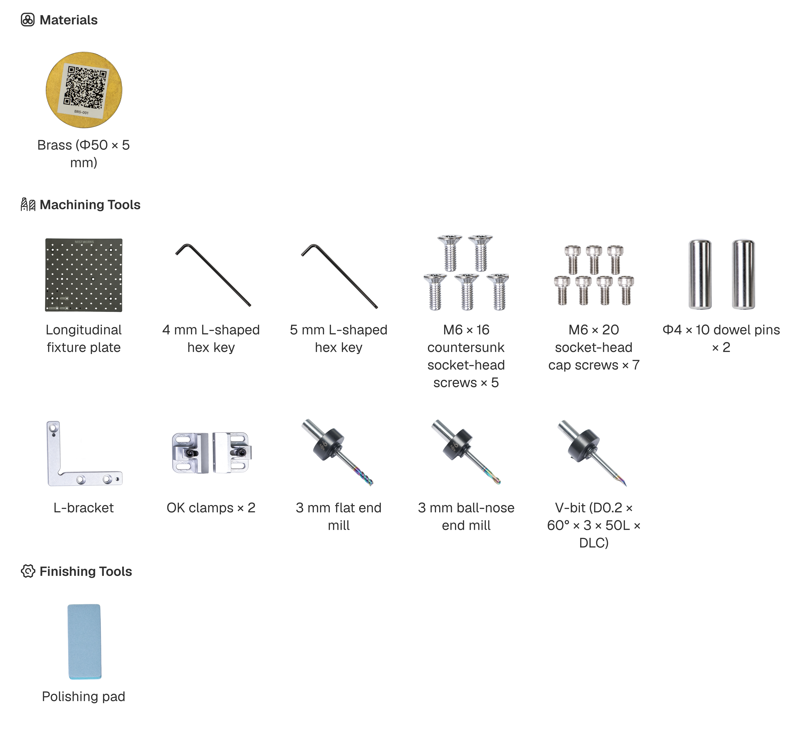
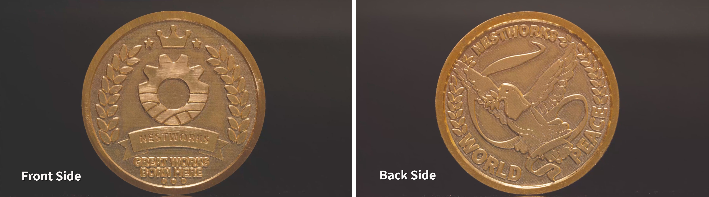

## Making a Brass Commemorative Coin

This project uses the C500 to machine a double-sided brass commemorative coin from a blank measuring Φ50 × 5 mm.

The project follows the 3-Axis, double-sided machining workflow described in Making a Wooden Electronic Clock. This tutorial focuses on the materials, cutting tools, workholding method, and project settings specific to the brass coin. Common operations, such as fixture calibration, machine connection, and tool detection, are not covered again. 

## Materials and Tools

Prepare the materials and tools shown below.

## Machining Workflow
### Workpiece Clamping
1. Install the fixture plate and insert the two dowel pins, then install the L-shaped locating fixture.
2. Position the Φ50 × 5 mm brass workpiece blank in the designated location. Install and tighten the two OK clamps, ensuring the blank is securely held.

## Start Machining

### Front-Side Machining

#### Import G-code File

Enter the **Home** page and import the G-code file for the front side of the coin.

#### Automatic Centering
1. Click **Switch Other Fixture**, select **CNC Milling**, and click **Confirm**.

2. Click **Switch Coordinate Input Mode** > **Next** > **Automatic** to automatically center the front side.

3. Once front-side centering is complete, start machining the front side of the workpiece.

### Back-Side Machining
1. Once front-side machining is complete, remove any chips from the surface, flip the coin over, and secure it again.

2. As with the front side, import the G-code file for the back side and perform automatic centering.

3. Remove the coin and clear any chips from its surface and engraved details. Finish the edges and remove any burrs as needed.

## Finished Workpiece

