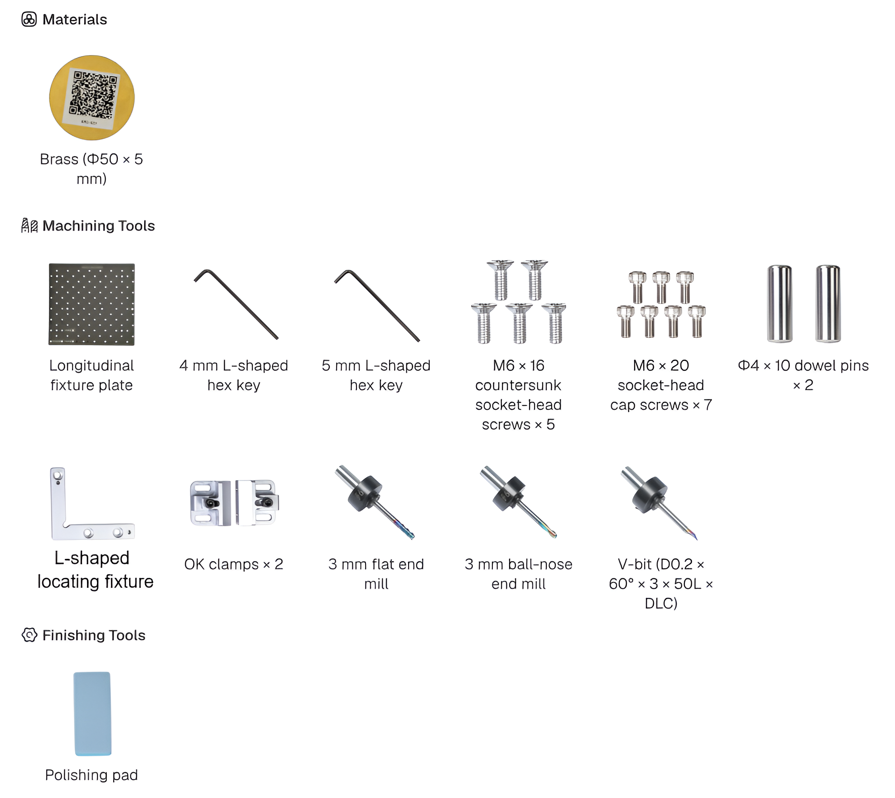
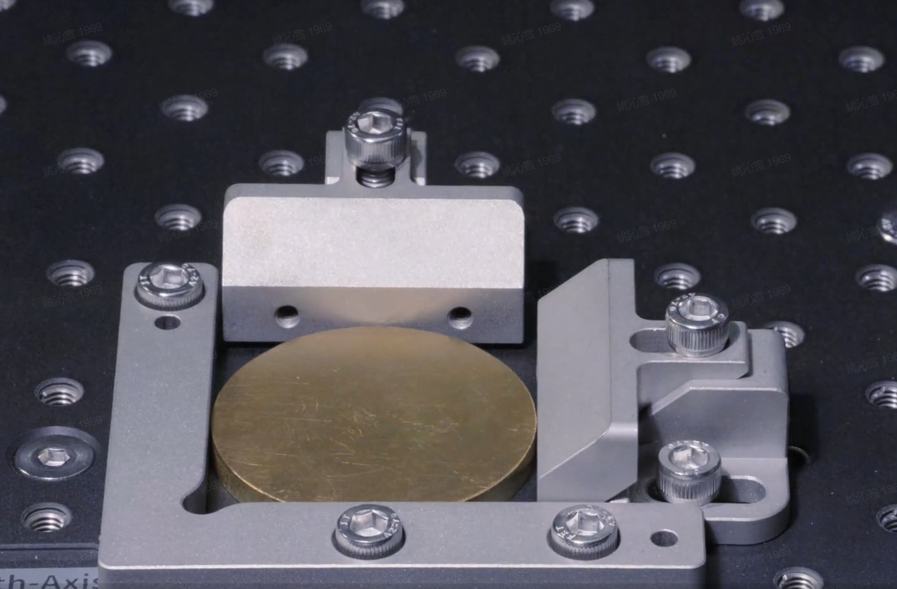
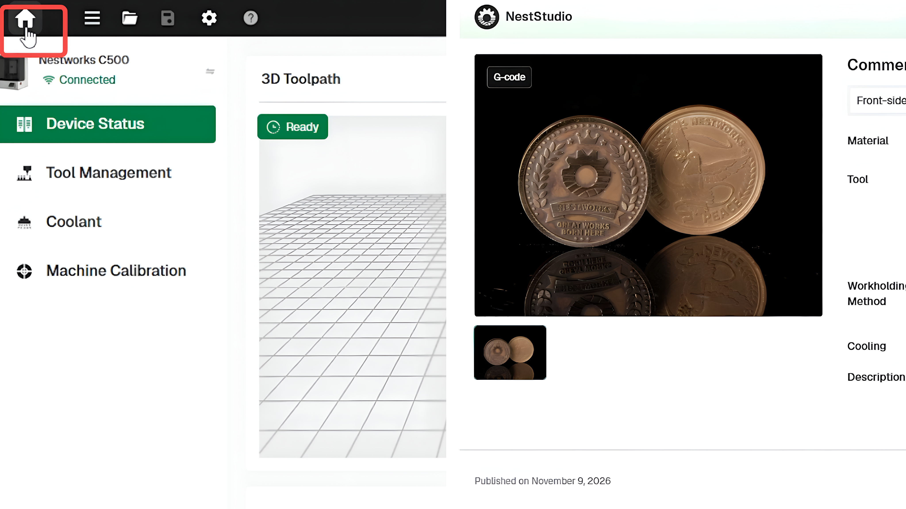
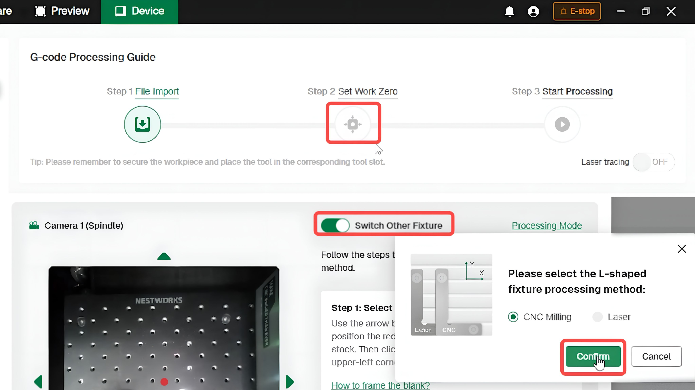
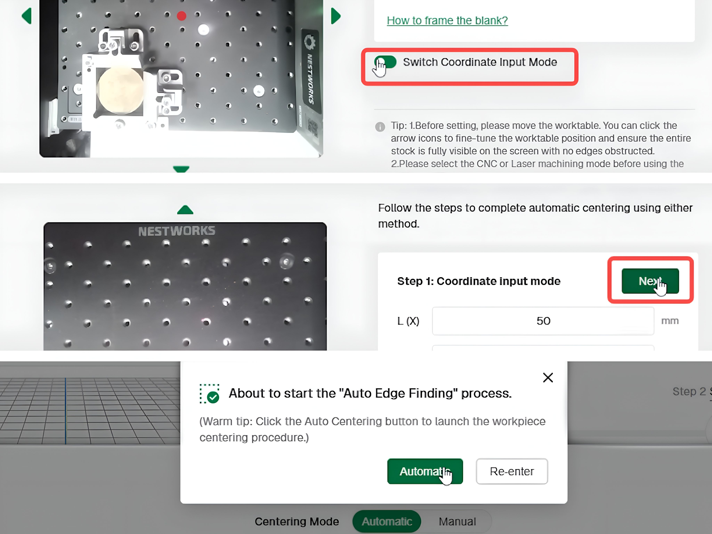
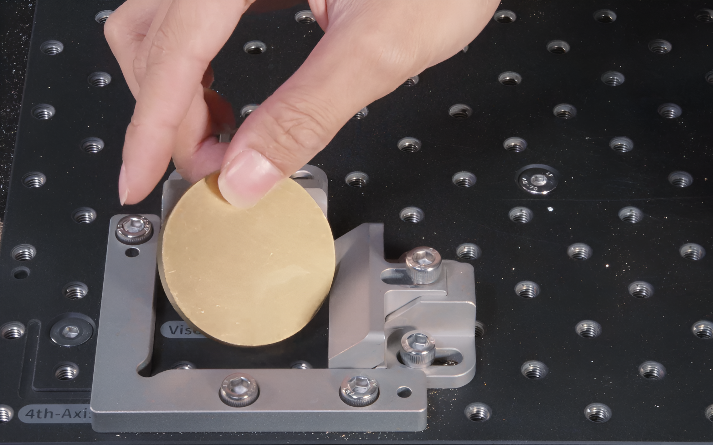

## Making a Brass Commemorative Coin

This project uses the C500 to machine a double-sided brass commemorative coin from a brass workpiece blank measuring Φ50 × 5 mm.

This project follows the 3-axis, double-sided machining workflow introduced in **Making a Wooden Electronic Clock**. This tutorial focuses on the materials, cutting tools, workholding method, and project settings specific to the brass coin. Common steps, such as fixture calibration, software connection, and tool setup, are not repeated here.

## Materials and Tools

Prepare the materials and tools shown below.

## Machining Workflow

### Workpiece Clamping
1. Install the fixture plate and insert the two dowel pins, then install the L-shaped locating fixture.
2. Position the Φ50 × 5 mm brass workpiece blank in the designated location. Install and tighten the two OK clamps, ensuring the workpiece blank is securely held.

### Tool Setup
1. Install the 3 mm 3-flute flat end mill, 3 mm 2-flute ball-nose end mill, and V-bit in the tool magazine.
2. Check the tool information in Tool Management and confirm that the software records match the tools installed in the magazine.

## Start Machining

### Front-Side Machining

#### Import G-code File

Enter the **Home** page and import the G-code file for the front side of the coin.

#### Automatic Centering
1. Click **Switch Other Fixture**, select **CNC Milling**, and click **Confirm**.

2. Click **Switch Coordinate Input Mode** > **Next** > **Automatic** to automatically center the front side.

3. Once front-side centering is complete, start machining the front side of the workpiece blank.

### Back-Side Machining
1. Once front-side machining is complete, remove any chips from the surface, flip the coin over, and secure it again.

2. As with the front side, import the G-code file for the back side and perform automatic centering.

3. Remove the coin and clear any chips from its surface and engraved details. Finish the edges and remove any burrs as needed.

## Finished Workpiece

