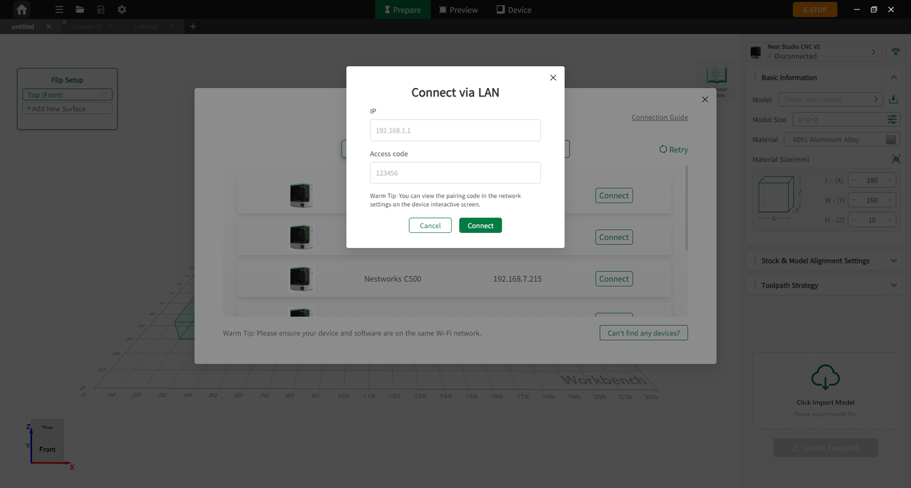

#### Wireless Connection

1. Connect the machine and the software to the same Wi-Fi network.
2. On the device's touchscreen, tap **Settings > Networks** to view the IP address and pairing code.
3. Enter NestStudio, click **Device**, click the network icon bellow the device model in the upper left corner, click **Wireless**, and enter the IP address and pairing code.

<!-- publication-image: {width=12cm} -->

<!-- mdwb:figure id=2b8c9dbe80d8e56f -->
Figure 5-4 Wireless Connection
<!-- /mdwb:figure -->

