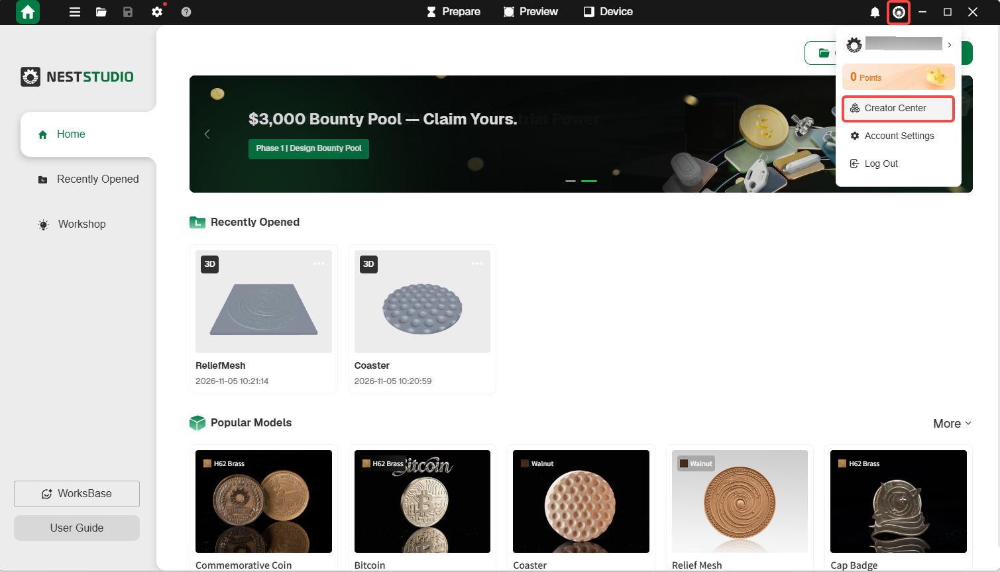

### CAM Software Access

1. Double-click the **NestStudio** to launch the software. If not installed, users can download it from the [www.nestworks.ai](http://www.nestworks.ai) .
2. Click the **User Account** in the top-right corner of the software toolbar, then select **Creator Center** from the dropdown menu to access WorksBase.

<!-- publication-image: {width=12cm} -->
