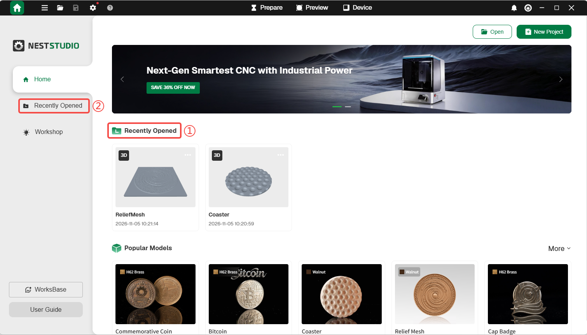
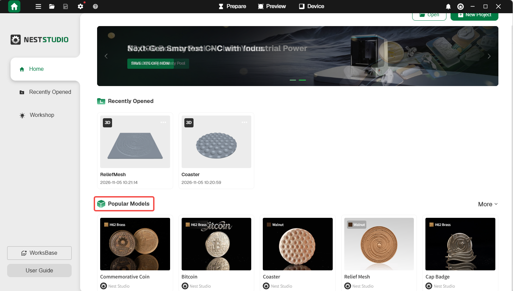
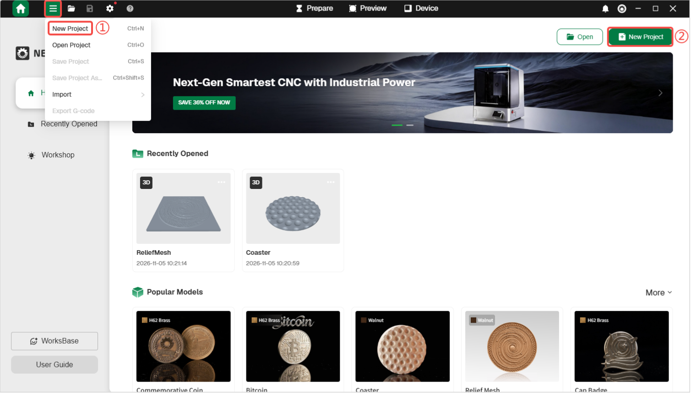
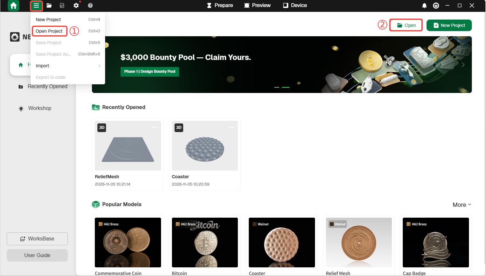
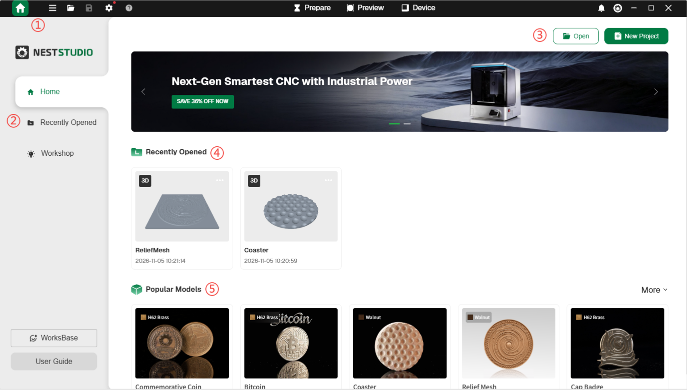

### Home

**Recently Projects**  

Quickly open projects that were recently edited or used.

<!-- publication-image: {width=12cm} -->

**Browse Popular Models**  

Browse pupular models and click to open them directly.

<!-- publication-image: {width=12cm} -->

**Create New Project**  

Quickly create a new NestStudio project.

<!-- publication-image: {width=12cm} -->

**Open Local Project**  

Click **Open** to open a local file. Supports all NestStudio files, 3D files, and NestStudio project packages.

<!-- publication-image: {width=12cm} -->

**Home Page Layout**

<!-- publication-image: {width=12cm} -->

| **No.** | **Feature**          | **Description**                                                                                                   |
| :-- | :--------------- | :--------------------------------------------------------------------------------------------------- |
| 1   | Main Toolbar     | Includes HOME, New Project, Import Drawing, Export Program, Save File, E-Stop, Account Settings, and Settings |
| 2   | Menu Bar         | Includes Home, Recent Files, Creative Workshop, User Guide and WorksBase          |
| 3   | Open/New project | Open local files or create a new project                                                                |
| 4   | Recently opened  | Quick access to recently saved files                                                                    |
| 5   | Popular Models   | Browse popular models and open files directly                                                           |

