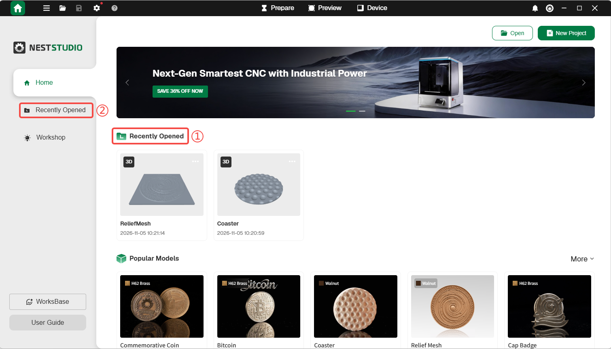
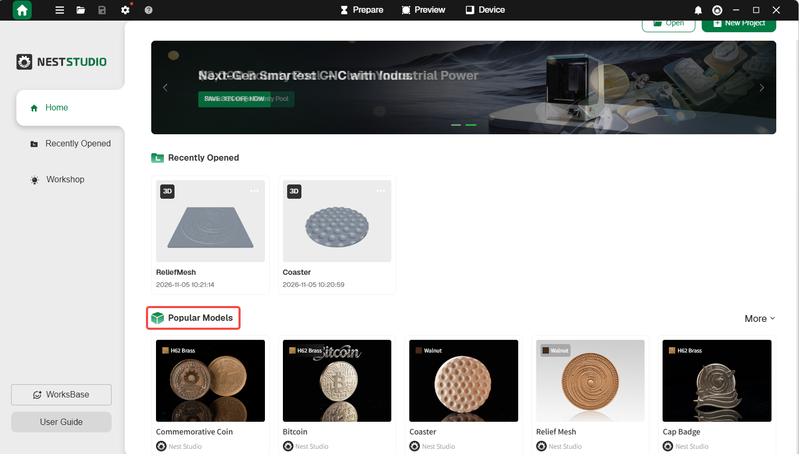
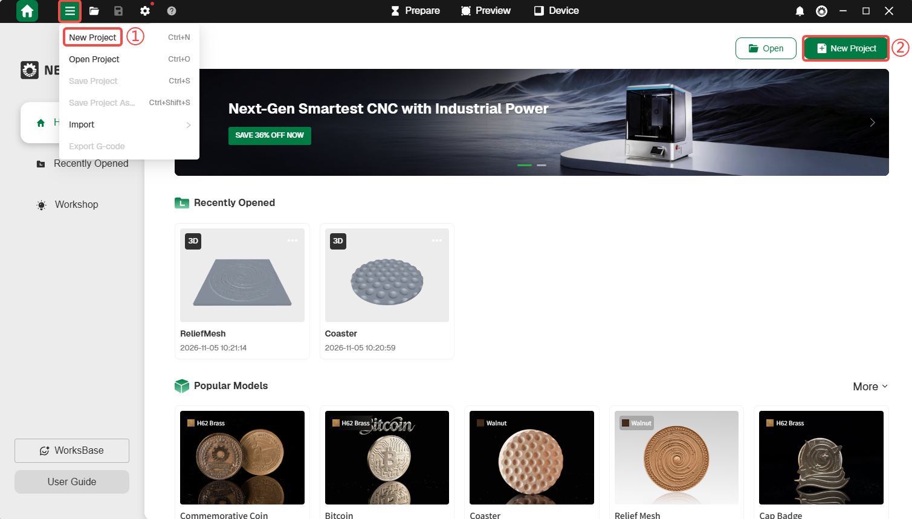
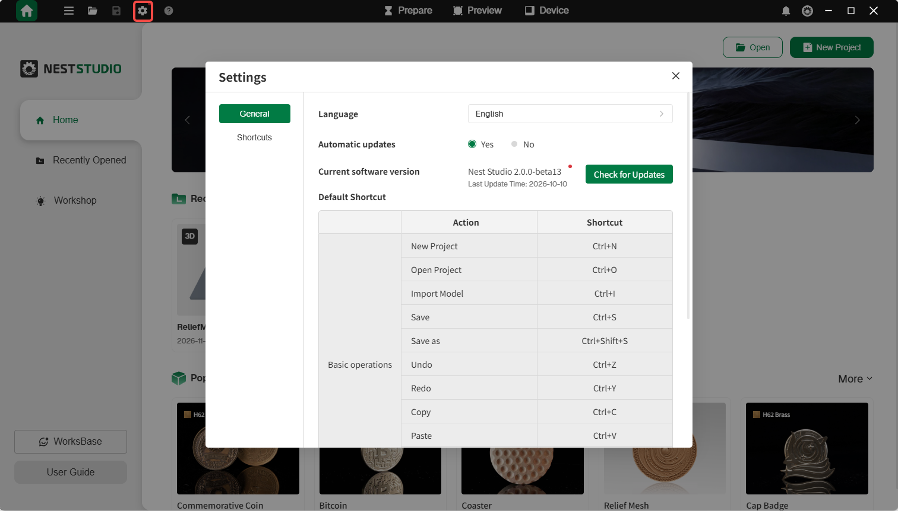
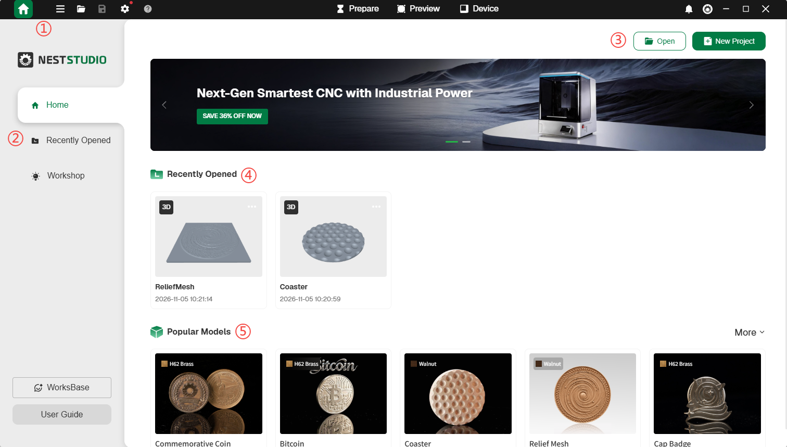

### Home

**Account Login**  

Log into your NestStudio account to access points, wallet and earnings.

**Recently Projects**  

Quickly open projects that were recently edited or used.

<!-- publication-image: {width=12cm} -->

<!-- mdwb:figure id=f9df557b7f2a1fdb -->
Figure 6-1 Recently Projects
<!-- /mdwb:figure -->

**Browse Popular Models**  

Browse pupular models and click to open them directly.

<!-- publication-image: {width=12cm} -->

<!-- mdwb:figure id=a6922aa5d5f22723 -->
Figure 6-2 Browse Popular Models
<!-- /mdwb:figure -->

**Create New Project**  

Quickly create a new NestStudio project.

<!-- publication-image: {width=12cm} -->

<!-- mdwb:figure id=13499613d2c80700 -->
Figure 6-3 Create New Project
<!-- /mdwb:figure -->

**Open Local Project**  

Click **Open** to open a local file. Supports all NestStudio files, 3D files, and NestStudio project packages.

**Software Settings**  

Customize software preferences according to user requirements.

<!-- publication-image: {width=10cm} -->

<!-- mdwb:figure id=9497df0a6915854a -->
Figure 6-5 Software Settings
<!-- /mdwb:figure -->

**Window Controls**  

Minimize, maximize, or close the software window.

**Messages**  

Click **Notice** on the right side of the top toolbar to view various messages, including activity updates, interaction messages, and system notifications.

**Home Page Layout**

<!-- publication-image: {width=12cm} -->

<!-- mdwb:figure id=b0724d8a1ffc748e -->
Figure 6-6 Home Page Layout
<!-- /mdwb:figure -->

| No. | Feature          | Description                                                                                                   |
| --- | ---------------- | ------------------------------------------------------------------------------------------------------------- |
| 1   | Main Toolbar     | Includes HOME, New Project, Import Drawing, Export Program, Save File, E-Stop, Account Settings, and Settings |
| 2   | Menu Bar         | Includes Home, Recent Files, Creative Workshop, User Guide and WorksBase     |
| 3   | Open/New project | Open local files or create a new project                                                                      |
| 4   | Recently opened  | Quick access to recently saved files                                                                          |
| 5   | Hot Models       | Browse popular models and open files directly                                                                 |

