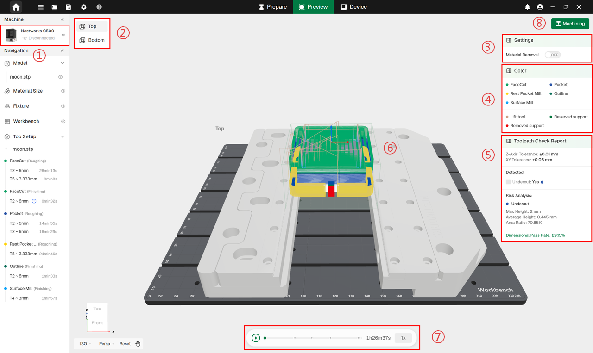

### Preview Page

Click **Preview** in the center of the top toolbar to enter the Preview interface. Users can review the generated toolpath effects, strategy parameters, and machining paths, and proceed directly to machining or export the G-code file.

<!-- publication-image: {width=12cm} -->

| **No.** | **Feature**          | **Description**                                                                                                                          |
| :------ | :------------------- | :--------------------------------------------------------------------------------------------------------------------------------------- |
| 1       | **Device Status**    | Displays the current connection status. If disconnected, users can click the icon on the right to connect via wired or wireless methods. |
| 2       | **Top (Bottom)**   | Supports switching between machining surfaces (Top/Bottom) to view toolpaths and check the toolpath planning for different surfaces.                                       |
| 3       | **Preview Settings**   | Turn on **Material Removal** to simulate how material is removed during machining and preview the final result.                   |
| 4       | **Operation Colors** | The colors of operations in the simulation preview match their corresponding color labels in the **Process Tree** on the left, making it easier to distinguish between operations.                                                                   |
| 5       | **Toolpath Check Report** | The toolpath check report is displayed on the right. It supports checking for risks such as collisions, over-cuts, or under-cuts in the toolpath, assisting in evaluating toolpath safety and the precision of the machining results.       |
| 6       | **Tool Path**      | Displays the machining toolpath.                                               |
| 7       | **Preview Video Playback**        | Set the playback speed of the toolpath video. Default is 1x; options include 0.25x, 0.5x, 2x, 4x, 8x, 16x, or 32x.                                                                                           |
| 8       | **Machining**           | Click **Machining** when the device is connected.                                                                                                                 |
