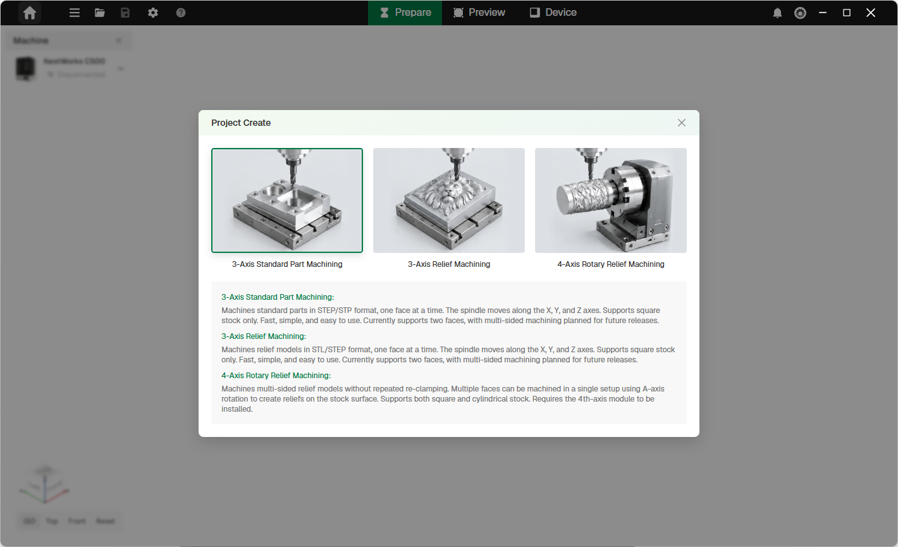

### Top Toolbar

**New Project**

1. Click **Menu > New Project**, or click the **New Project** in the upper-right corner of the Home page to create a new project.
2. Select the machining mode based on the workpiece features.

   

**Open Project**

Click **Menu > Open Project** to select the file, or click the **Open** button in the upper-right corner of the Home page to browse for files.

**Save Project**

Click **Save Project** to open a pop-up window. Users can choose to save the project file to either local computer or cloud storage.

**Save Project As**

Click **Save Project As** to save the current project as a separate file with a new name or file path.

**Import**

Click **Import** to select the type of file to be imported:

- Import 3D model (STL/STEP)
- Import G-code file

Users can also drag and drop target files directly from their desktop into the software workspace for a quick import.

**Export G-code File**

Click **Export Gcode** to export the finalized data into a G-code machining file.

**Software Settings**  

Customize software preferences according to user requirements.

**Messages**

Click **Notice** on the right side of the top toolbar to view various messages, including activity updates, interaction messages, and system notifications.

**Account Login**

Log into your NestStudio account to access points, wallet and earnings.

**Window Controls**

Minimize, maximize, or close the software window.

