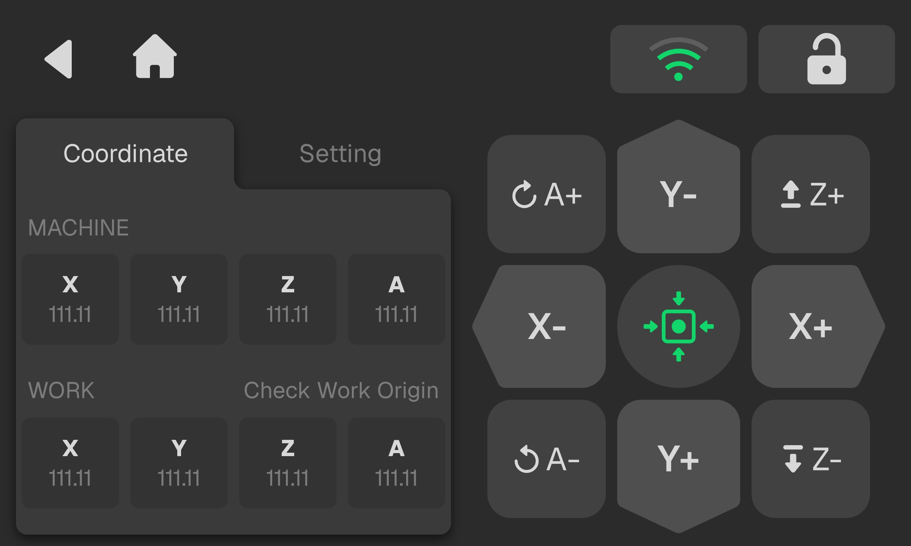

### Spindle Motion Panel

The panel provides manual motion control for the X, Y, and Z axes. Users can:

- Click once to jog the axis.
- Press and hold to move the axis continuously.
- Click **Settings** to open the motion parameter settings page.

When the 4th-Axis expansion module is installed and detected by the system, the interface displays “4th-Axis Connected”, and the panel enables manual control of the A axis.

<!-- publication-image: {width=12cm} -->

<!-- mdwb:figure id=c3c6b2d71320740a -->
<!-- /mdwb:figure -->

