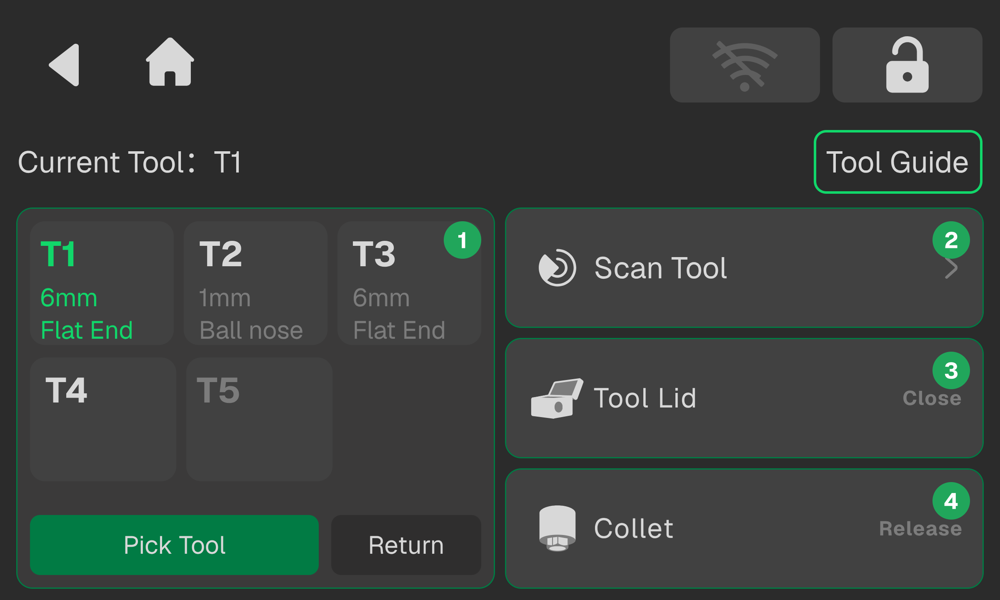

## Tool Management

<!-- publication-image: {width=12cm} -->

<!-- mdwb:figure id=c219712ae36d84d8 -->
<!-- /mdwb:figure -->

| **No.** | **Name**                | **Description**                                                                                                                                                                                                                                                                                                                                  |
| :------- | :----------------------- | :------------------------------------------------------------------------------------------------------------------------------------------------------------------------------------------------------------------------------------------------------------------------------------------------------------------------------------------------ |
| 1       | **Tool Change**         | Displays the current spindle tool number and T1–T5 tool positions. Select a tool number and click **Pick Tool**; the spindle automatically retrieves the tool and moves to the tool setter for calibration. Z-axis coordinates are calculated based on tool length. Click **Return Tool** to return the tool to its position.                    |
| 2       | **Tool Information**    | Click **Scan Tools** to quickly read RFID tool information and sync to the interface. Successfully read tools are highlighted with a green border and show size/type; empty if no information; tool position numbers are greyed out if no tool is present. Click **Start Scan** to rescan tools. Click **Confirm** to overwrite old information. |
| 3       | **Tool Magazine Door**  | Single click to manually open or close the tool magazine door.                                                                                                                                                                                                                                                                                   |
| 4       | **Collet Setup**        | Click **Release** to open the collet and remove the tool, click **Clamp** to secure the tool, and click **Tool Set** to move to the tool setter and calibrate the Z-axis.                                                                                                                                                                        |

