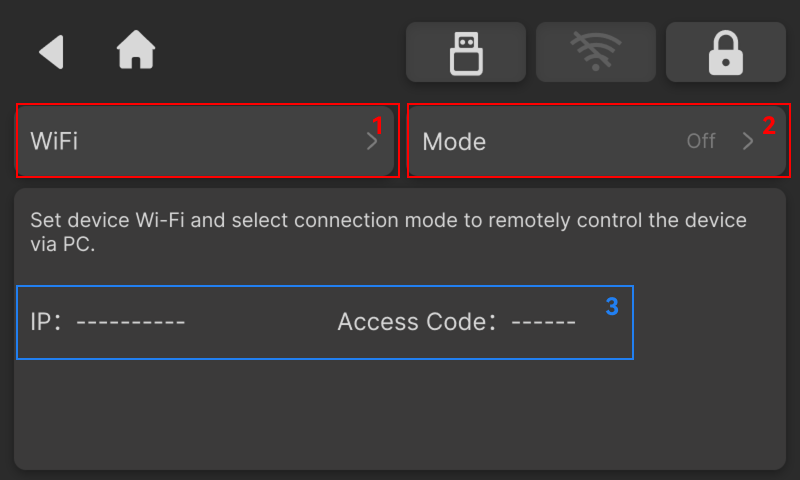

### Network Settings

The Network Settings page allows users to connect to a Wi-Fi network, check for software and firmware updates, and sign in to their accounts.

It also supports connecting to NestStudio on a PC via LAN Mode, Ethernet Direct, or wired LAN/PLC. The page provides the IP address and pairing code required to establish the connection.

<!-- publication-image: {width=12cm} -->

<!-- mdwb:figure id=7979f1580c1aa609 -->
Figure 6-12 Network Settings
<!-- /mdwb:figure -->

| No. | Item                   | Description                                                                                                  |
| :--- | :---------------------- | :---------------------------------------------------------------------------------------------------------- |
| 1   | Wi-Fi                  | Connect to a wireless network                                                                                |
| 2   | Mode                   | Three connection methods are supported as follows: - LAN Mode  - Ethernet Direct  - Wired LAN / PLC |
| 3   | Connection Information | Displays the information required to establish the connection, including the IP address and pairing code     |

