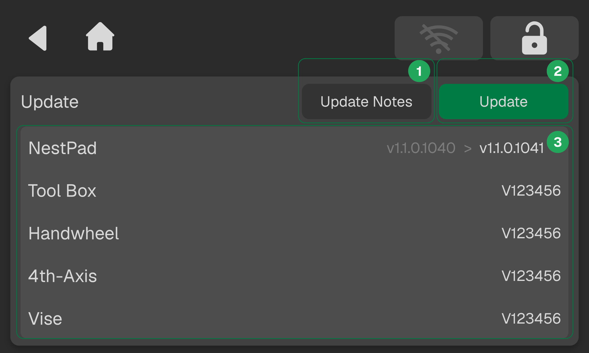

### Updates

The Update page displays the current NestPad software and firmware versions. When a new version is available, a "New" label is highlighted on the page.

Tap **Update Notes** to view details of the updates. Tap **Update** to update all items.

<!-- publication-image: {width=12cm} -->

<!-- mdwb:figure id=72cb35660b4e5a97 -->
<!-- /mdwb:figure -->

| **No.** | **Item**     | **Description**                                                                                                     |
| :--- | :-------- | :--------------------------------------------------------------------------------------------------------------- |
| 1   | Update Notes | View the release notes for the current version, including new features, bug fixes, etc.                                                                             |
| 2   | Updates | One-click detection to check if the NestPad software and accessory firmware need updates. |
| 3   | Version List | Displays the current version numbers of each module, including the NestPad software and connected accessories (such as the tool magazine, handwheel, 4th axis, vise, etc.). |

> [!caution] Caution
> 
> During the update process, the system will automatically download and install the update package. Do not power off the device or disconnect the power supply during the update.

