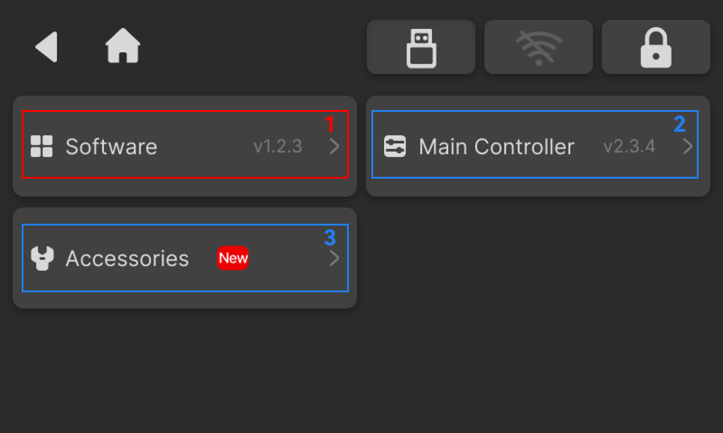

### Updates

The Update page displays the current software and firmware versions. When a new version is available, a "New" label is highlighted on the page. Tap **Update** to update all available items.

<!-- publication-image: {width=12cm} -->

<!-- mdwb:figure id=72cb35660b4e5a97 -->
Figure 6-13 Updates
<!-- /mdwb:figure -->

| No. | Item            | Description                                                                                                     |
| :--- | :--------------- | :--------------------------------------------------------------------------------------------------------------- |
| 1   | Software        | Update the NestPad software version                                                                             |
| 2   | Firmware        | Update firmware for device accessories, including the 4th-axis, MPG Handwheel, tool magazine, and electric vise |

> [!note] Notice
> During the update process, the system will automatically download and install the update package. Do not power off the device or disconnect the power supply during the update.

