### Calibration and Tools

The Calibration and Tools page provides device self-check and device setup tools.

<!-- publication-image: {width=10cm} -->

#### Self Diagnosis

After this function is enabled, the device automatically starts the self-check when powered on. You can also tap **Start Diagnosis** on the current page to manually start the check and verify whether communication with each functional module is normal.

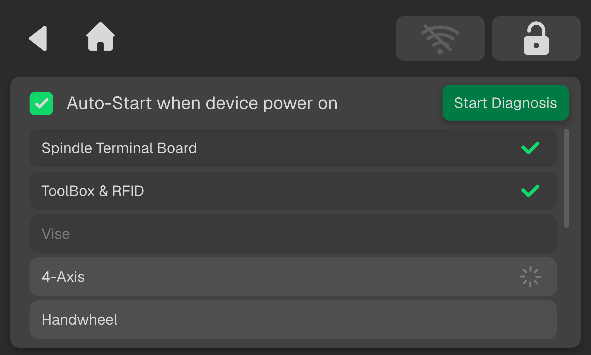<!-- publication-image: {width=10cm} -->

#### Probe Control

This function allows you to manually extend and retract the probe. Tap **Move Down** to extend the probe, or tap **Move Up** to retract it.

<!-- publication-image: {width=10cm} -->

#### Probe Calibration

Probe calibration corrects probe offsets along the X, Y, and Z axes to improve the accuracy of automatic centering and positioning. Because calibration involves actual cutting, prepare the blank and tool as specified below, then follow the on-screen instructions to complete the procedure.

> [!danger] Danger
> 
> - Do not touch the blank or probe during calibration. Keep your hands and tools out of the machine's travel area.
>   
> - Do not open the protective door or touch moving machine components during machining.

> [!caution] Caution
>
> - The machine cuts the blank during probe calibration. Before starting, make sure the blank is securely clamped, the tool is installed correctly, and the machining area is clear of foreign objects.
>   
> - Do not perform a machine zero return during probe calibration. This may shift the machine zero position and cause calibration error.
>   
> - If an abnormal condition, power loss, or interruption occurs, stop the procedure and restart it according to the troubleshooting instructions in this guide.

**Tools and Materials**

- Aluminum blank for calibration, at least 50 × 50 × 20 mm
- 6 mm flat end mill installed in tool position T1
- Soft brush or vacuum cleaner for removing chips and dust from the groove in the blank and around the probe

**Calibration Procedure**

1. Secure the aluminum calibration blank (at least 50 × 50 × 20 mm) on the worktable. Ensure it is firmly clamped and that a 6 mm flat end mill compatible with the calibration program is installed in tool position T1.
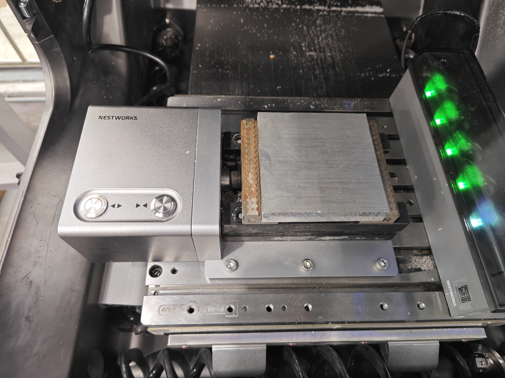<!-- publication-image: {width=12cm} -->

2. Tap **Home > Settings > Calibration > Probe Calibration** to enter the probe calibration page in NestPad. Check the on-screen instructions and machine status, then tap **Start Calibration**.
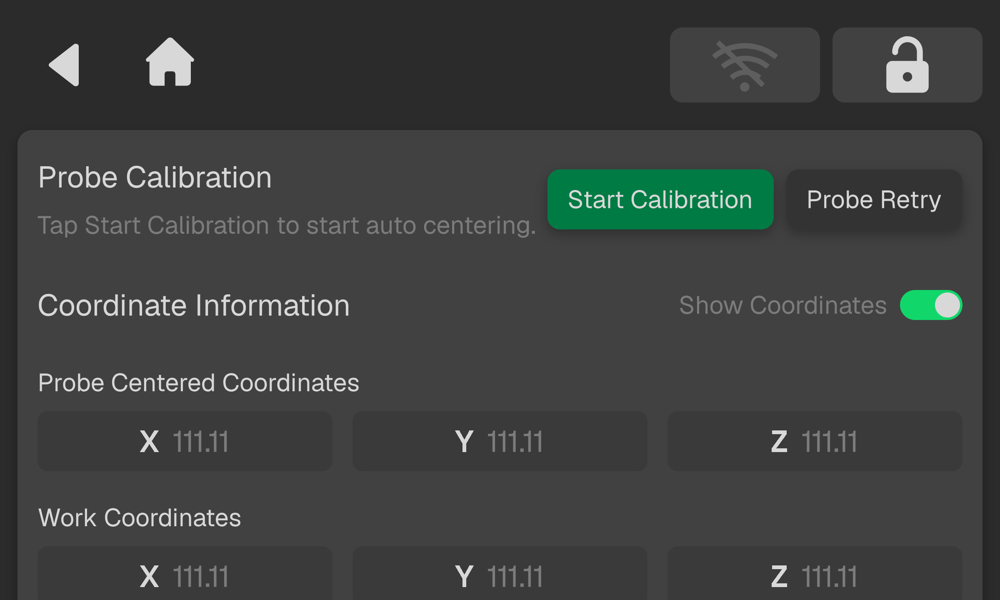<!-- publication-image: {width=12cm} -->

3. After calibration is complete, the system switches to the automatic centering interface. Follow the instructions provided on the interface.
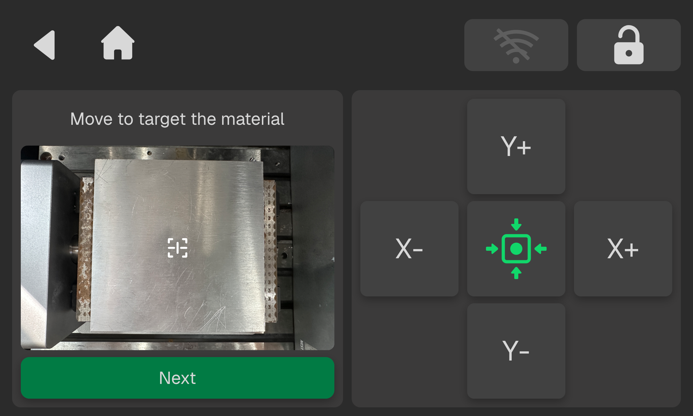<!-- publication-image: {width=12cm} -->

4. After automatic centering is complete, the system switches to the machining interface. Recheck the blank, tool, and protective door. Close the protective door and tap **Start**. Wait for the calibration groove to finish machining.
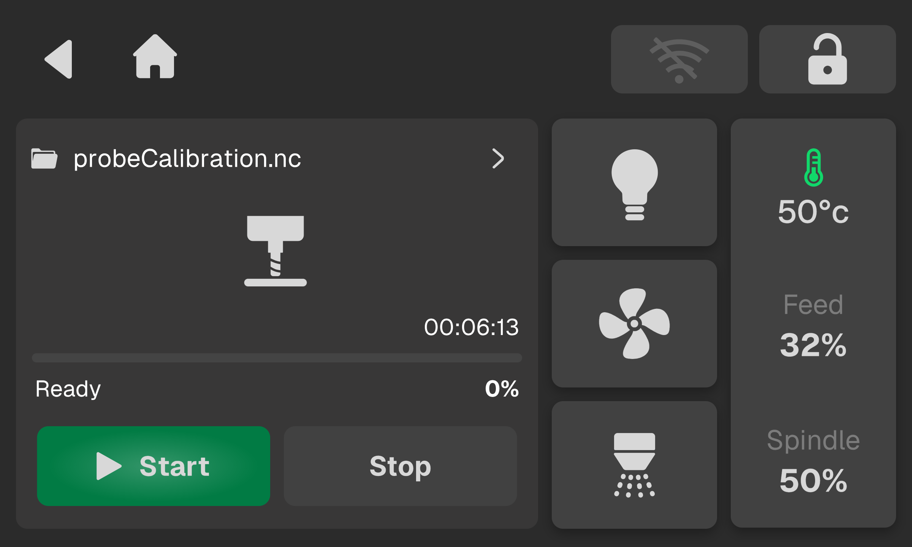<!-- publication-image: {width=12cm} -->

5. After machining is complete, the system returns to the calibration interface and prompts you to remove the chips. Wait until the machine has come to a complete stop, then open the protective door in accordance with the machine's safety procedures. Use a soft brush or vacuum cleaner to remove chips from the groove. Keep the blank and fixture in place during cleaning. After cleaning, close the protective door and tap **Continue**.
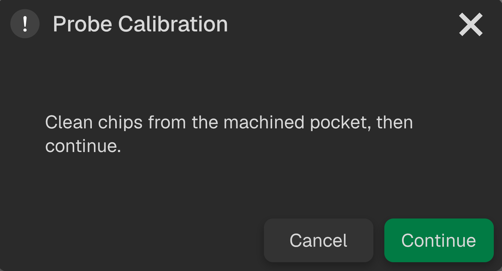<!-- publication-image: {width=12cm} -->

6. The system automatically extends the probe to measure the bottom and surrounding area of the groove, then verifies the calibration result. Do not move the machine manually or touch the blank or probe during this process.

7. When the "Probe Calibration Successful" message appears, tap **Confirm**. The system automatically applies the calibration values, so no manual entry is required.

**Daily Cleaning**

Before and after each calibration, check the probe and surrounding area for chips, dust, or oil residue. Clean the probe and surrounding area promptly after machining, and remove any contamination before taking measurements.

If the probe is bent, loose, damaged, or malfunctioning, stop using it and contact technical support. Do not disassemble or adjust the probe mechanism yourself.

**Troubleshooting**

| **Issues**        | **Corrective Action**                                        |
| :-------------- | :------------------------------------------------  |
| Calibration failed | Remove chips from the groove as instructed on the screen. If the blank and fixture remain in place and the interface allows reprobeing, tap **Probe Again**. If the blank has moved or the clamping setup has changed, tap **Start Calibration** to repeat the full calibration procedure.|
| System fails to return to the calibration interface after machining | Manually open the calibration page. The system will prompt you to remove chips from the groove; follow the prompt to continue the calibration process. If **Cancel** was selected accidentally, continue as instructed only if the blank and fixture have not moved and the interface still offers Probe Again. Otherwise, restart calibration.|
| Procedure interrupted or power loss | If power is lost during calibration or before machining begins, restart the procedure from the beginning. If power is lost while the calibration groove is being machined or the probe is taking measurements, replace the blank and repeat the machining process.  |
| Risk of collision, probe malfunction, or machine alarm | Stop the procedure immediately, eliminate the hazard, and follow the on-screen instructions. Do not continue calibration if the probe, blank, or fixture is incorrectly positioned. |
| The emergency stop button is pressed during calibration | When the emergency stop button is pressed, all axes stop immediately, and the coordinate reference is lost. The current calibration data becomes invalid, and calibration cannot continue. Release the emergency stop and reset the machine. Perform a homing operation to re-establish the coordinate reference, then tap **Start Calibration** to repeat the entire calibration procedure.  |

#### Tool Lid Angle Reset

This function is used to calibrate the reference angle of the tool box door. If the system detects an abnormal door angle or the door does not open or close properly, perform this reset operation to recalibrate the door's opening and closing angles, ensuring that the door operates correctly.

**Prerequisites**

Before performing the reset, make sure there are no obstructions within the tool box door's range of motion.

**Procedure**

After confirming that it is safe to proceed, tap **Home > Settings > Calibration > Tool Lid Angle Reset** to access the Tool Lid Angle Reset page. Tap **Reset** to complete the angle calibration.

<!-- publication-image: {width=10cm} -->

#### Tool Box Calibration

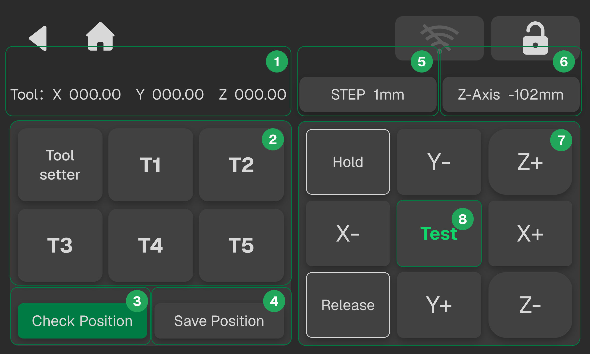<!-- publication-image: {width=10cm} -->

| **No.** | **Name**                   | **Description**                                                                                                                                                                |
| :--- | :---------------------- | :-------------------------------------------------------------------------------------------------------------------------------------------------------------------------- |
| 1   | **Coordinate Information** | Displays the X, Y, and Z coordinates of the currently selected tool or tool setter.                                                                                        |
| 2   | **Tool Number**            | Displays the tool setter and tool numbers. When an item is selected, the coordinate information above is updated accordingly.                                              |
| 3   | **Check Position**         | After selecting a tool or the tool setter, click this button. The spindle moves directly above the corresponding tool or tool setter so that its position can be checked.  |
| 4   | **Save Position**          | Saves and updates the current spindle coordinates as the coordinates of the selected tool or tool setter.                                                                  |
| 5   | **Jog Increment**          | Sets the distance the spindle moves each time a motion button is clicked.                                                                                                  |
| 6   | **Z-Axis Height Settings** | Sets the fixed Z-axis height for tool retrieval.                                                      |
| 7   | **Motion Panel**           | Supports spindle movement along the X, Y, and Z axes. Use the **Hold** and **Release** buttons to control the collet.                                                      |
| 8   | **Test Button**            | Click **Test** to perform a tool pickup or tool-setting operation based on the currently selected tool or tool setter, verifying whether the current position is accurate. |

**Calibration Procedure**

1. Select any tool position on the left, then tap **Check Position**. After the tool magazine cover opens, the spindle moves above the corresponding tool. Visually check whether the spindle is aligned with the tool.
3. Use the motion control panel on the right to move the spindle and adjust its position. Once the spindle is aligned with the tool, tap **Save Position** to save and update the coordinates of the current tool position.
4. After confirming that the spindle is aligned with the tool, you can also tap **Test** to verify that the tool pickup and return operations work properly and that the positions are accurate. Once everything is confirmed, tap **Confirm** on the calibration completion screen to save and update the coordinates of the current tool position.
   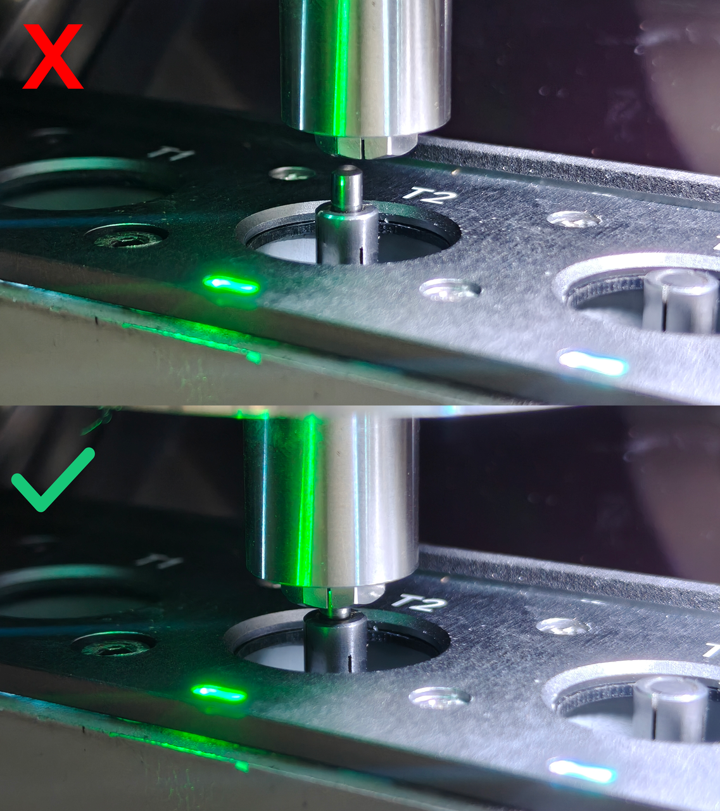<!-- publication-image: {width=10cm} -->

   > [!caution] Caution
   >
   > The spindle should be aligned as closely as possible with the tool. When performing this operation, it is recommended to set the step size to 0.1 or 0.01 for fine adjustments to prevent collisions caused by accidental operation.
   > 
   > Before calibrating the tool setter, make sure a tool is installed in the spindle. Otherwise, the tool setter calibration cannot be completed.

#### Camera Rotation

Camera rotation corrects image orientation deviations caused by the camera's physical installation and aligns the image coordinate system. This ensures accurate coordinate calculations and recognition across all vision-based functions (e.g., camera monitoring, workpiece centering, visual inspection, and QR code recognition).

The device supports independent rotation settings for the Monitoring Camera and Centering Camera.

**Procedure**

1. Go to **Settings > Calibration > Camera Rotation** to enter the Camera Rotation page. Tap either the **Monitoring Camera** or **Centering Camera** to enter the corresponding preview and adjustment interface.
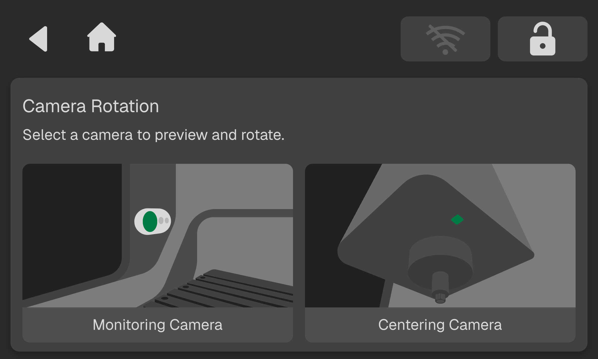<!-- publication-image: {width=10cm} -->

2. The left side shows the real-time camera preview, while the right side displays the current camera rotation angle.
   - Rotation Direction: Click **CW (clockwise)** or **CCW (counterclockwise)** to rotate the image.
   - Rotation Step: Select from 1°, 5°, 15°, or 90°. Click the step button to change the rotation increment applied each time.
   - The preview updates in real time as the image rotates, and the angle value updates accordingly.
   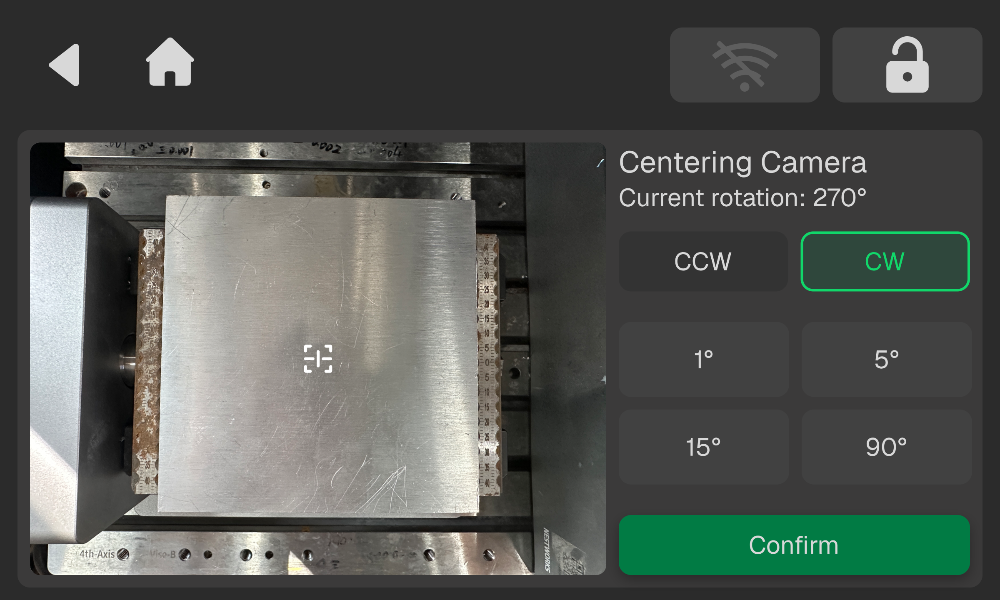<!-- publication-image: {width=10cm} -->

3. Adjust the image until its orientation matches the machine's physical orientation, then tap **Confirm** to save the settings. The settings are saved permanently and remain in effect even after the machine restarts.
   
   > [!note] Notice
   > 
   > The two cameras have independent rotation settings. Adjusting one camera does not affect the other.
   > After replacing, removing, reinstalling, or repositioning the camera, it is recommended to check and recalibrate its rotation direction.
   > All vision-based functions (e.g., workpiece centering, object detection, and QR code recognition) use these rotation settings.
   
#### L-Shaped Locating Fixture Calibration

**L-Shaped Locating Fixture Calibration** automatically probes the fixture's reference points and calibrates its coordinates on the worktable.

The probe collects the fixture's reference points, allowing the system to automatically identify its installation mode (CNC or Laser) and calculate the fixture's corner coordinates and tilt angle.

The calibration results provide reference data for subsequent L-shaped locating fixture centering, helping ensure accurate workpiece zero-point positioning and reduce errors caused by manual tool setting.

**Pre-calibration Preparations**

| **Items**       | **Description**                                   |
| :-------- | :-------------------------------------- |
| Machine Status    | Confirm that the machine has completed homing, all axes are moving normally, and there are no lingering alarms. |
| Probe             | Confirm that the probe is correctly installed, securely connected, and undamaged.    |
| Fixture Setup     | Confirm that the L-shape locating fixture is securely clamped in the designated position on the worktable and is within the system's recognizable probing range.                           |
| Communication     | Confirm that communication between the machine controller and the system is normal, with no disconnections or interference.                            |
| Work Area     | Confirm that there are no extra workpieces, tools, or debris within the machine's travel range.                        |
| Emergency Stop     | Confirm that the machine's emergency stop switch is functioning properly and can be triggered at any time in case of an anomaly.                      |

Execute the L-shaped locating fixture calibration only after all the above conditions are confirmed.

**Procedure**
1. Secure the L-fixture in the designated position on the worktable, ensuring it is firmly clamped.
2. Tap **Home > Settings > Calibration > L-Fixture Calibration** to enter the calibration page, and then tap **Calibrate**. The system will enter the automatic execution process.
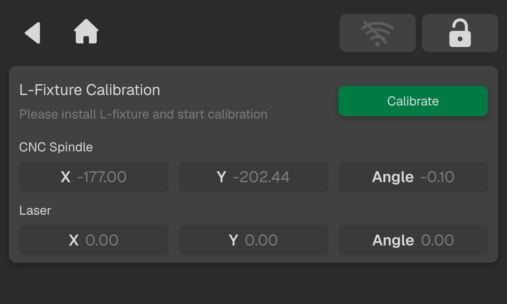<!-- publication-image: {width=10cm} -->

3. The probe will sequentially complete the Z-axis surface height measurement of the worktable, X-axis edge finding, and Y-axis edge finding to collect the fixture's reference points and automatically determine the fixture's installation mode. After point collection is completed, the probe will retract, and the spindle will return to the safe height.

   > [!caution] Caution
   >
   > If a tool is installed in the spindle, it will first be returned to its home position to avoid the risk of a tool-probe collision. Subsequently, the spindle will be raised to a safe height, move to the preset probing start point, and extend the probe to prepare for measurement.

4. When the pop-up displays "Calibration Complete", tap Confirm. The system automatically saves the fixture's X and Y coordinates and tilt angle.

   > [!caution] Caution
   >
   > The L-shaped locating fixture must be recalibrated after initial installation, reinstallation, or any change in its position.
   > Calibration involves automatic machine movements. Do not move the fixture or touch the probe during calibration to prevent probing failures or collisions.
   > If an alarm, anomaly, or manual stop occurs during calibration, troubleshoot the issue and confirm equipment safety before restarting the calibration.

   > [!note] Notice
   > 
   > Calibration parameters will be saved automatically. Directly view the corresponding fixture calibration data for both CNC and Laser modes.

#### Soft Limit Configuration

Soft limits are used to define the safe travel range of the spindle, restricting the axis movement range before the hard limits are triggered. As preemptive safety protection, it reduces the risk of machine collisions and protects the lead screws, tools, and workpieces. Since individual assembly errors exist in every machine, soft limits must be recalibrated after machine adjustments, spindle disassembly/assembly, or a collision.

When **Soft Limit Configuration** is enabled, the spindle triggers an alarm and motion is restricted if it exceeds the configured travel range. When disabled, only the first-level protection provided by the hardware limits remains active. This mode is intended only for maximum travel testing. Keep soft limits enabled during normal machining.

**Pre-calibration Preparations**

Before calibration, please confirm the following conditions are met:
- Ensure the tool has been removed from the spindle.
- Ensure that no 4-Axis, vise, or workpiece is installed on the worktable (The tool magazine can remain installed.)
- Ensure there are no obstructions or interference risks in the machining area.
- Ensure the machine is at its correct zero position. If the system detects a deviation, perform homing before proceeding.

**Procedure**
1. Tap **Home > Settings > Calibration > Soft Limit Configuration** to enter the soft limit settings page, and then tap **Start**. The system will enter the automatic calibration process.
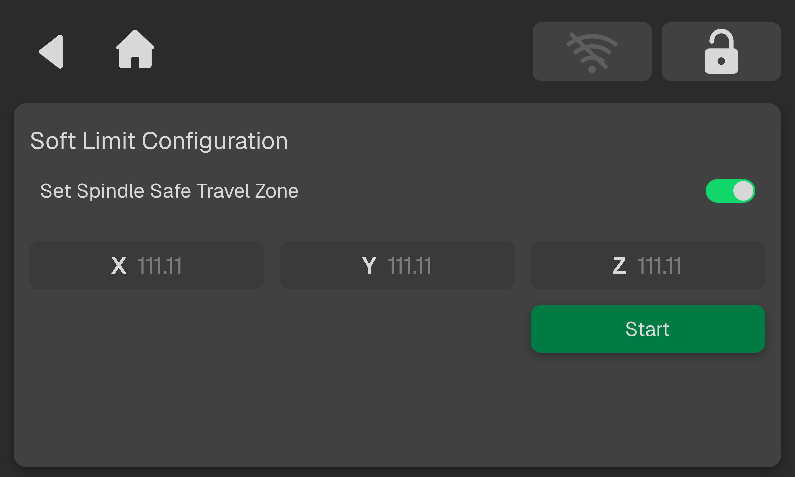<!-- publication-image: {width=10cm} -->

2. Once calibration starts, the spindle will move sequentially towards the hard limits in the following directions: X-axis left, Y-axis rear, and Z-axis downward. Upon touching the hard limit, it will rebound by 1 mm in the opposite direction, and this position will be recorded as the soft limit boundary for the corresponding axis.

3. After the three axes are measured, the device will automatically return to its home position. The interface will display "Soft limit calibration complete." and automatically save the soft limit parameters for the X, Y, and Z axes.

   > [!caution] Caution
   >
   > Do not touch the spindle, cut power, or forcibly stop the device during calibration.

   > [!note] Notice
   > 
   > Recalibrate the soft limits after removing and reinstalling the spindle, readjusting the machine, or any collision.

