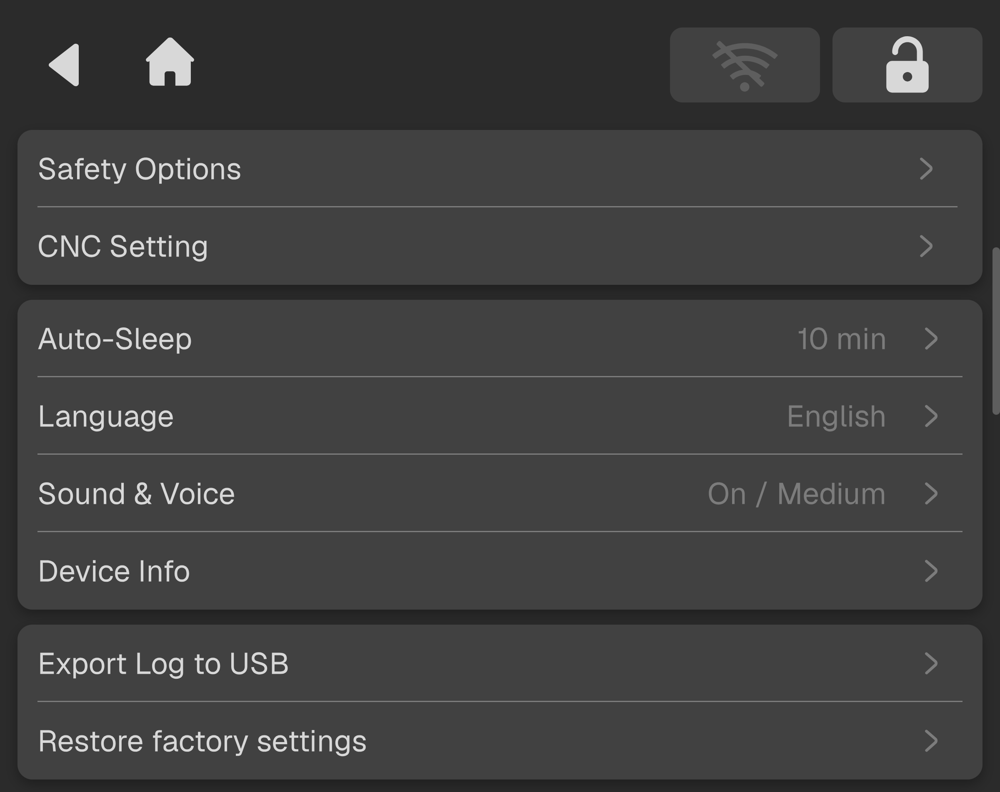

### Preferences

The Preferences page provides multiple device function and system parameter configuration options. Users can customize settings according to actual usage requirements.

<!-- publication-image: {width=12cm} -->

<!-- mdwb:figure id=281543b3353ff8ca -->
<!-- /mdwb:figure -->

| **Name**                | **Description**                                                                                                                                           |
| :------------------- | :----------------------------------------------------------------------------------------------------------------------------------------------------- |
| **Safety Options** | Sets safety-related options for machine operation.                                                                                                    |
| **CNC Settings**    | Sets machining-related preferences, such as units and auto-sleep settings.                                                                            |
| **Auto-Sleep**      | Set the sleep timer for the NestPad screen (options: 2 mins, 5 mins, 10 mins). Sleep mode can also be disabled.                                                                              |
| **Language**        | Switches the system display language, including Chinese, English, and other supported languages.                                                      |
| **Sound & Voice**   | Turns machine sound effects and voice prompts on or off.                                                                                              |
| **Device Info**     | Displays and manages device information, including editing the device nickname, viewing the usage time, and checking the unique device serial number. |
| **Export Log to USB**      | Exports machine logs to a USB drive for troubleshooting by technical support personnel.                                                               |
| **Restore Factory Settings**      | Clear all preferences and local data to restore the device to its factory settings. This action cannot be undone. Back up your files and export logs before proceeding.                                                               |
