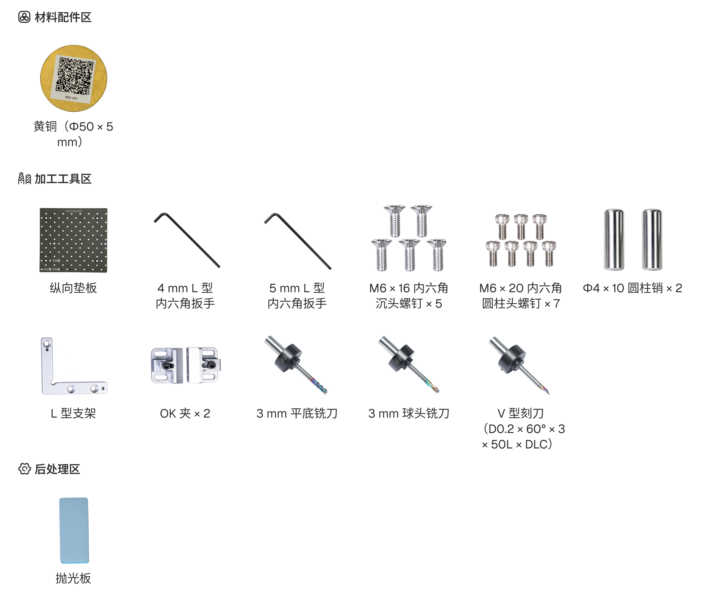
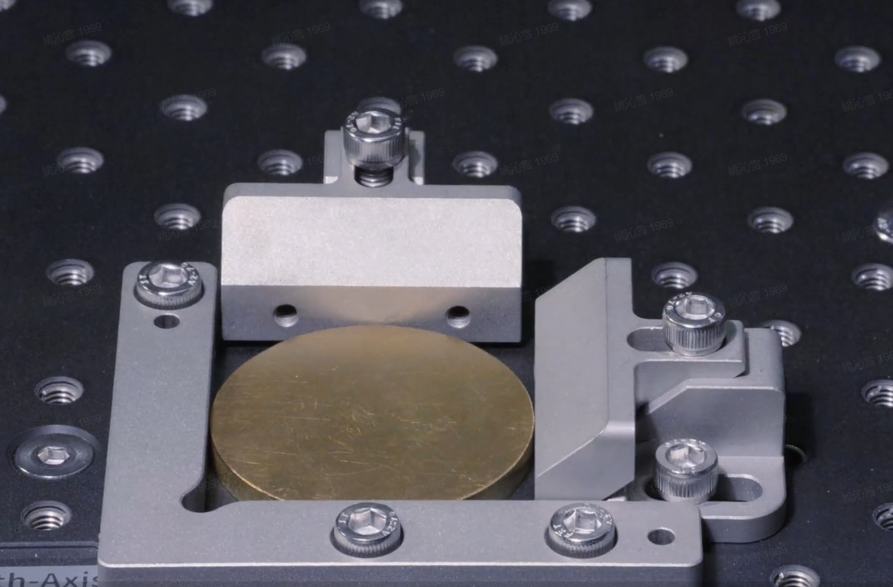
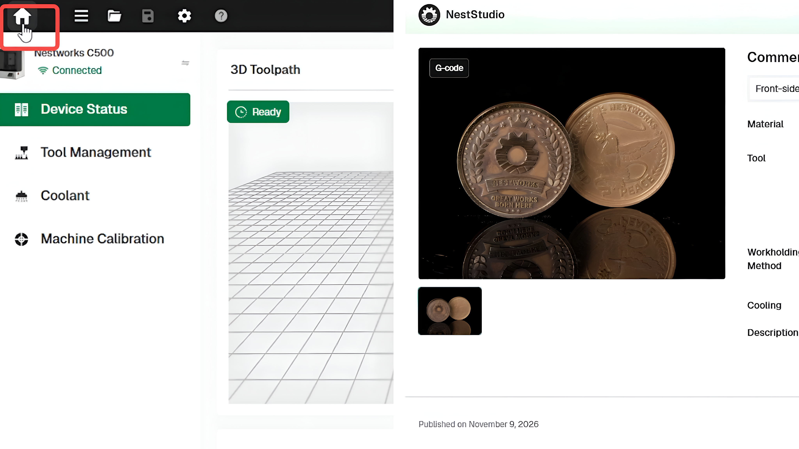
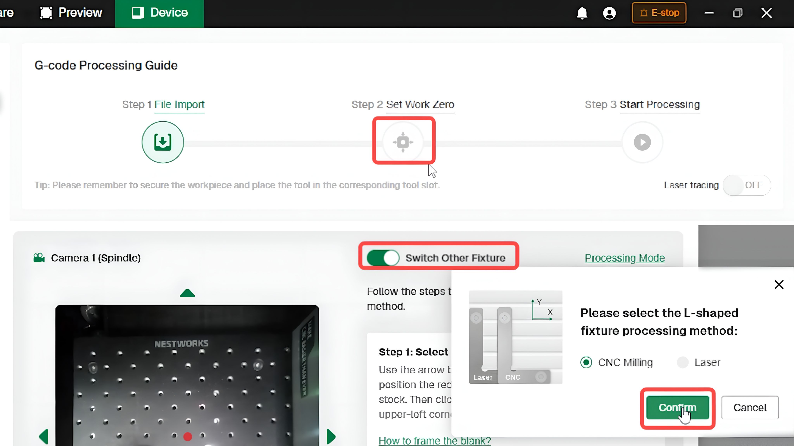
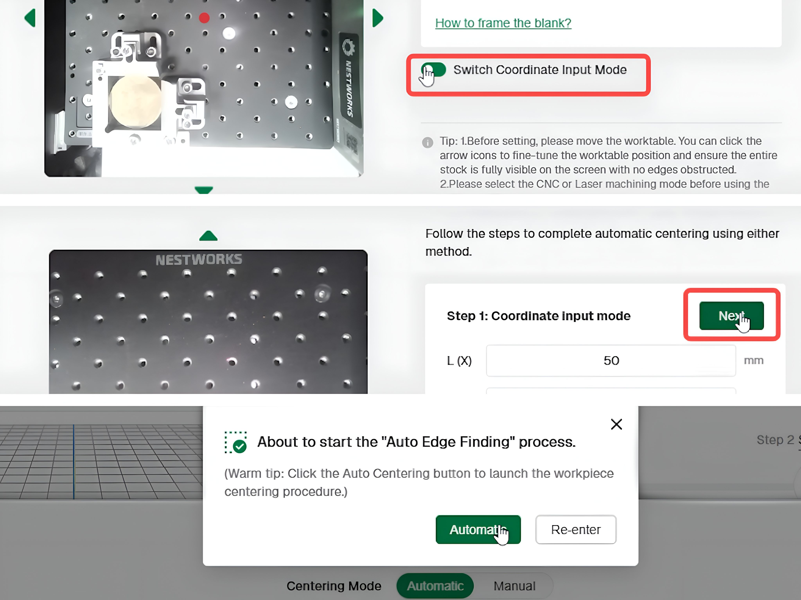
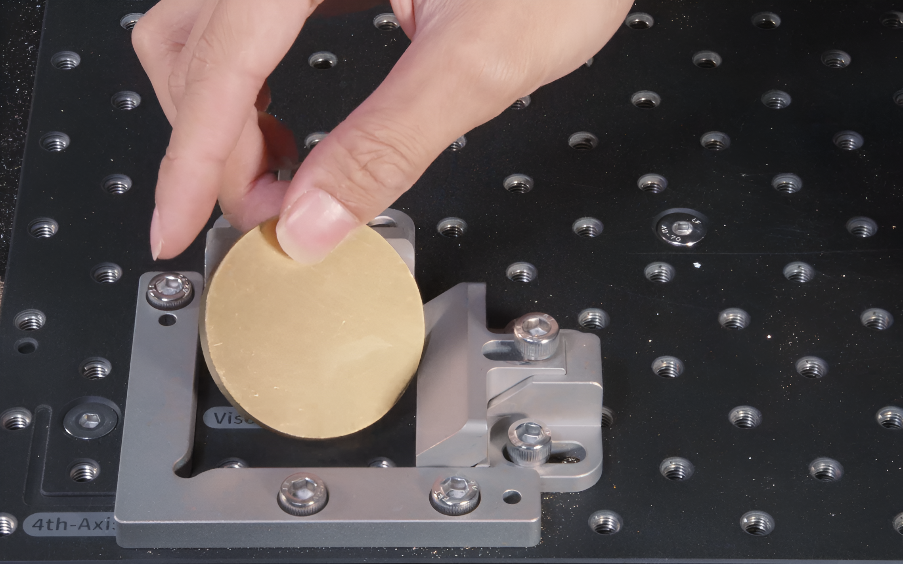
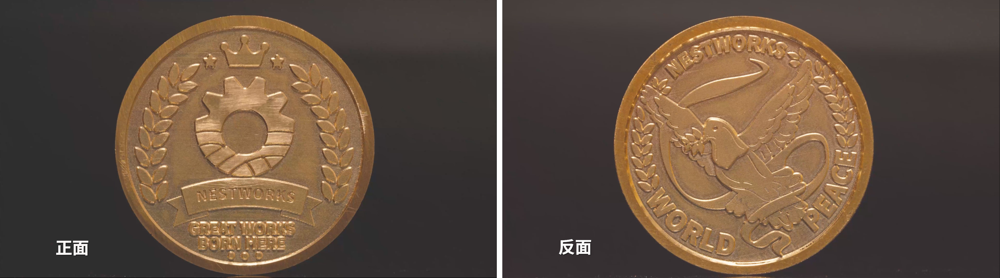

# 制作黄铜纪念币

本案例使用 C500 加工一枚双面黄铜纪念币，毛坯尺寸为 Φ50 × 5 mm。

本案例沿用[制作木制电子钟表](<02 制作木制电子钟表.md>)中的三轴双面加工流程。本教程仅说明黄铜纪念币所使用的材料、刀具、装夹方式及项目设置；夹具校准、设备连接、刀具读取等共用操作不再重复介绍。

## 材料与工具

准备下图所示的材料与工具。

<!-- publication-image: {width=14cm} -->

## 加工流程

### 材料装夹

1. 安装垫板并放入两根圆柱销，随后安装 L 型支架。
2. 将 Φ50 × 5 mm 黄铜圆片放置到指定位置，安装两个 OK 夹并拧紧，确认材料夹持稳固。

### 刀具安装

1. 将 3 mm 三刃平底铣刀、3 mm 两刃球头铣刀和 V 型刻刀安装到刀库。
2. 在刀具管理中核对刀具信息，确认软件记录与实际安装一致。

## 开始加工

### 正面加工

#### G-code文件导入
进入 **Home** 界面，导入纪念币正面 **G-code**文件。

#### 自动分中
1. 点击 **Switch Other Fixture**，选择 **CNC Milling** 铣削加工方式，并点击 **确认** 。

2. 点击 **Switch Coordinate Input Mode** > **Next** > **Automatic**，执行正面分中。

3. 正面分中结束后，执行工件正面加工。

### 反面加工及成品后处理
1. 正面加工完成后清理表面碎屑，将纪念币翻面并重新夹紧。

2. 与正面加工操作一样，导入反面G-code文件后，执行反面分中。

3. 取出纪念币，清除表面和纹路中的碎屑，并根据实际情况处理边缘及毛刺。

## 成品展示

