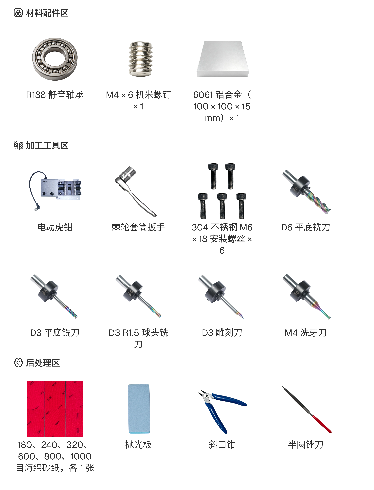

# 制作指尖陀螺

本案例使用 C500 加工一个由主体和两个对锁组成的指尖陀螺。

本案例沿用[制作木制电子钟表](<01 制作木制电子钟表.md>)中的三轴双面加工流程，重点介绍电动虎钳装夹、多模型布局、支撑设置和零件装配。设备连接、刀具读取、基础刀路生成和自动分中等共用操作不再重复介绍。

## 材料与工具

准备下图所示的材料与工具。

<!-- publication-image: {width=14cm} -->

## 加工流程

### 1. 电动虎钳安装

1. 确保设备已断电，以工作台上的“Vise A”为定位点放置电动虎钳。
2. 放入并拧紧固定螺钉，确认电动虎钳安装稳固。
3. 将电动虎钳接入设备并拧紧连接接口。

> 待插入：电动虎钳定位、固定及接口连接图。

### 2. 材料装夹

1. 将材料放入电动虎钳，使材料位置符合本案例的装夹要求。
2. 使用控制按钮调整夹持位置，再将材料夹紧。
3. 检查材料是否贴合夹持面，确认材料稳固且无明显倾斜。

> 待插入：材料放置、夹持位置调整及装夹完成图。

### 3. 加工设置

1. 选择“三轴”加工模式，导入陀螺主体和两个对锁模型，并按实际材料设置材料类型和尺寸。
2. 调整三个模型的位置和方向，确认模型之间留有足够间距，并避开虎钳夹持区域。
3. 添加支撑；进入“高级策略”，手动选择“轮廓”策略和 3 mm 平底铣刀，通过“选边”指定轮廓边线，保存并核对策略参数。
4. 进入“定制”，选择本案例使用的刀具，生成并预览正面刀路。
5. 添加“翻转设置”，完成反面刀具及刀路设置，并预览反面刀路。

> 待插入：三模型布局、支撑位置、轮廓选边、正反面刀路设置及预览界面。

### 4. 开始加工

1. 选择正面加工刀路，完成自动分中；确认定位结果正确后，关闭防护门并开始加工。
2. 正面加工完成后清理材料表面的切屑，取下材料并按翻转设置重新装夹。
3. 对反面重新执行自动分中，确认定位正确后完成反面加工。
4. 取出材料，将主体和两个对锁从余料上分离，去除支撑并处理边缘毛刺。
5. 按装配图安装主体、对锁、轴承及紧固件，确认各零件安装到位后测试陀螺转动是否顺畅。

> 待插入：正面加工、材料翻面、反面加工、零件分离、去除支撑及装配过程图。

## 成品展示

> **成品展示区**  
> 待插入：指尖陀螺整体、拆分结构及转动效果图。

