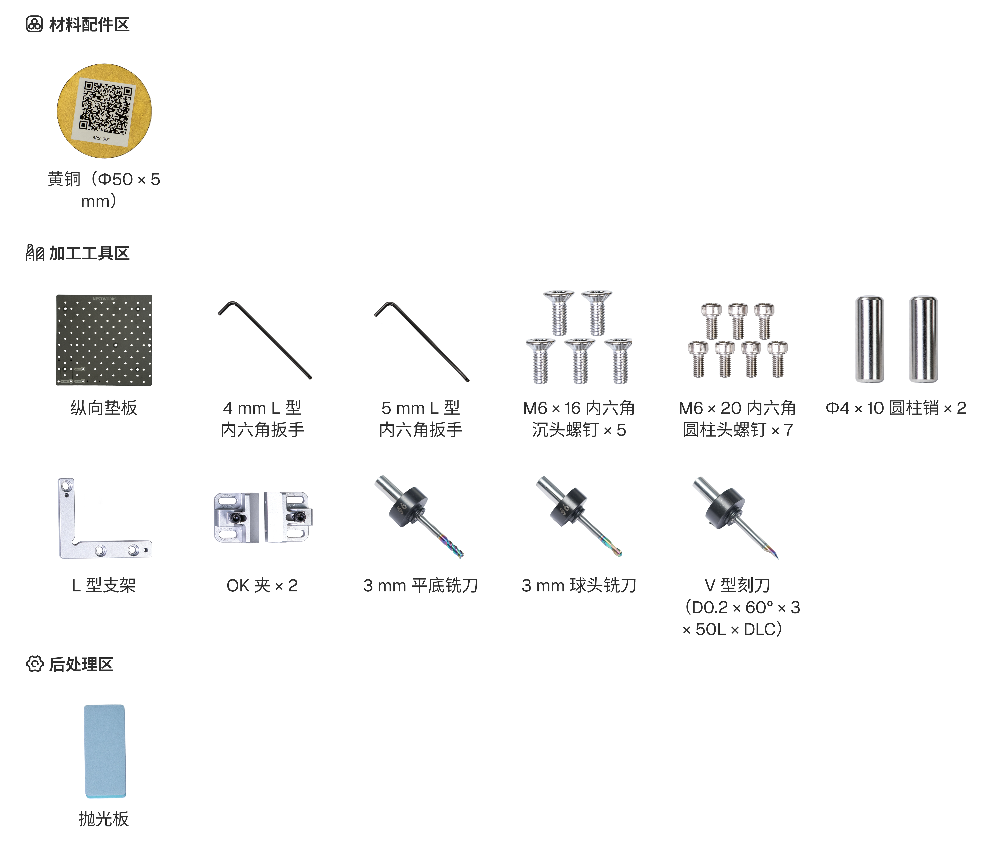
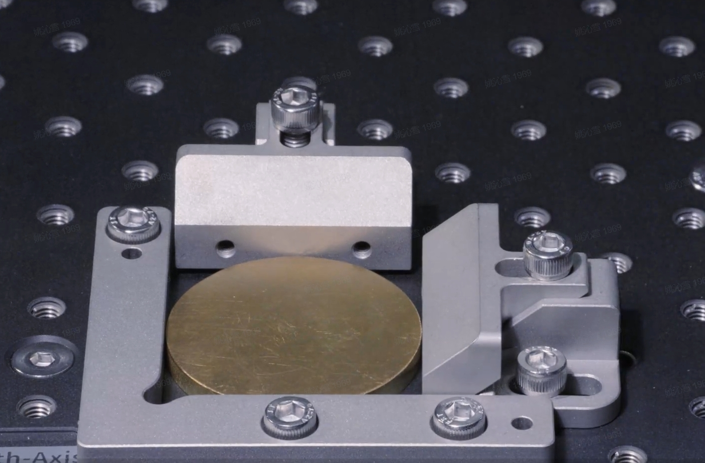
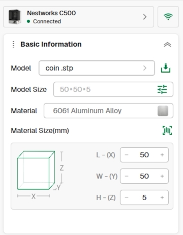
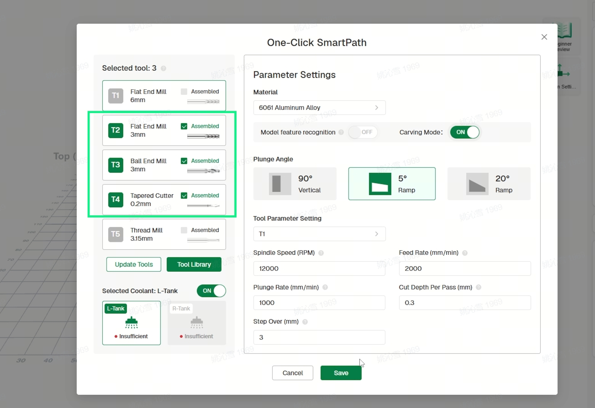
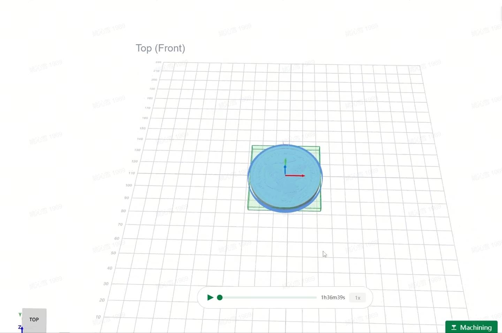
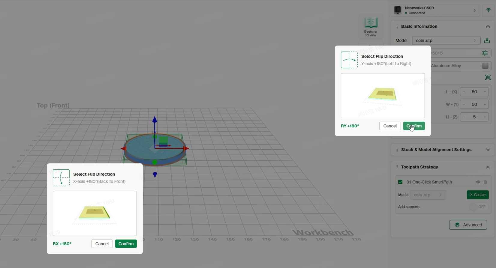
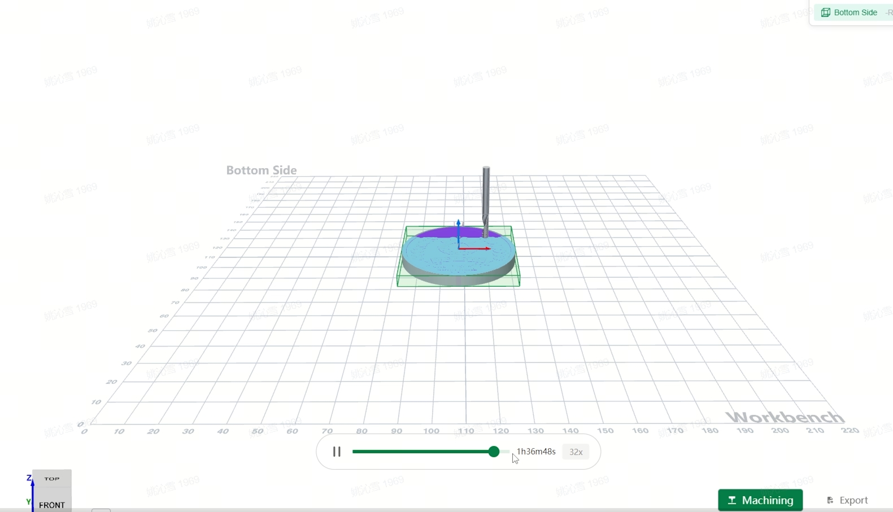

# 制作黄铜纪念币

本案例使用 C500 加工一枚双面黄铜纪念币，毛坯尺寸为 Φ50 × 5 mm。

本案例沿用[制作木制电子钟表](<02 制作木制电子钟表.md>)中的三轴双面加工流程。本教程仅说明黄铜纪念币所使用的材料、刀具、装夹方式及项目设置；设备连接、刀具读取、自动分中、刀路生成、翻面加工等共用操作不再重复介绍。

## 材料与工具

准备下图所示的材料与工具。

<!-- publication-image: {width=14cm} -->

## 加工流程

### 材料装夹

1. 安装垫板并放入两根圆柱销，随后安装 L 型支架。
2. 将 Φ50 × 5 mm 黄铜圆片放置到指定位置，安装两个 OK 夹并拧紧，确认材料夹持稳固。

### 刀具安装

1. 将 3 mm 三刃平底铣刀、3 mm 两刃球头铣刀和 V 型刻刀安装到刀库。
2. 在刀具管理中核对刀具信息，确认软件记录与实际安装一致。

### 加工设置

1. 选择“三轴”加工模式，导入纪念币模型；点击右侧“智能识料”功能图标，扫描二维码可自动填充待加工工件参数信息。

2. 进入“定制”，选择本案例使用的三把刀具，生成正面刀路并进行预览。

3. 添加“翻转设置”，选择反面加工所需的刀具，生成并预览反面刀路。

### 开始加工

1. 选择正面刀路并开始加工。
2. 正面加工完成后清理表面碎屑，将纪念币翻面并重新夹紧（翻转方向须与前面设置的翻转方面一致）。
3. 取出纪念币，清除表面和纹路中的碎屑，并根据实际情况处理边缘及毛刺。

