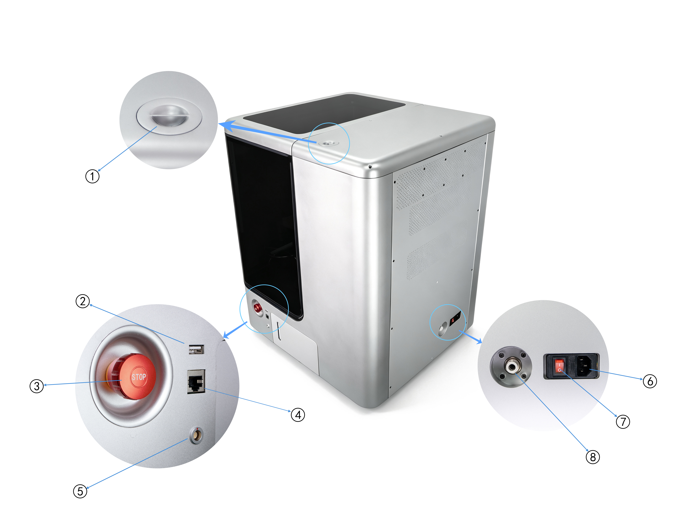
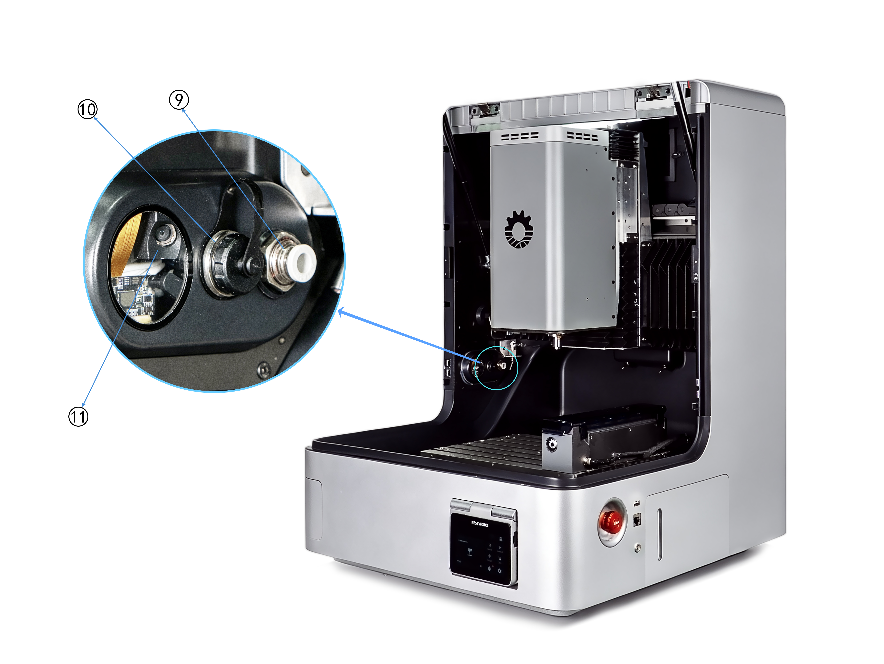
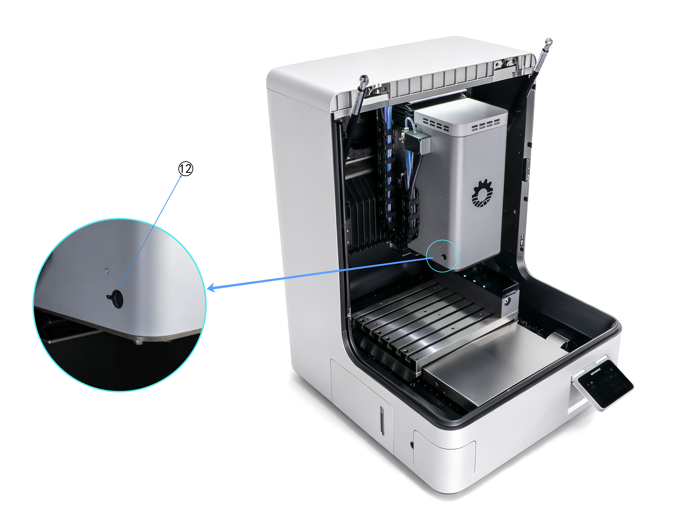
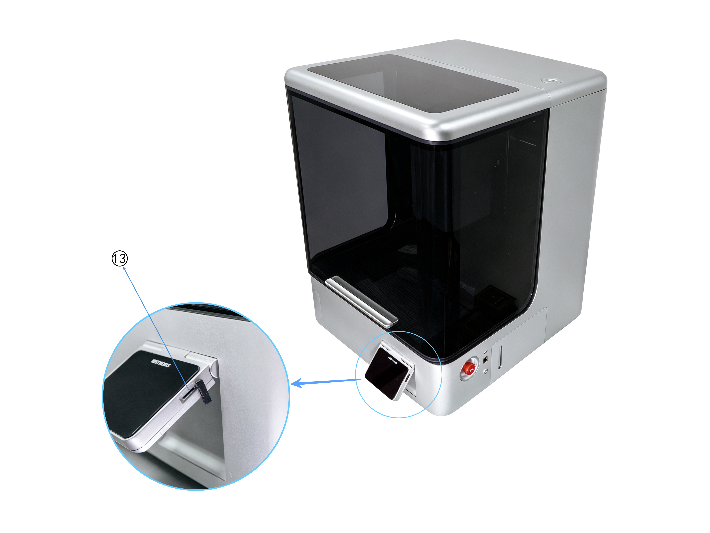

# 使用说明

本指南面向首次使用 NestWorks C500 的用户，通过开箱与首次启动说明，以及四个循序展开的指导案例，帮助您快速了解设备、NestStudio 和基本加工流程。

本指南仅介绍完成开箱和指导案例所需的操作，不能替代《NestWorks C500 用户手册》。有关设备安全、安装要求、适用材料、操作限制、维护和故障排查等完整信息，请查阅官方 Wiki。

# 安全须知

操作 NestWorks C500 前，请阅读并遵守以下安全要求。

> [!danger] 危险
> 所有配件均不支持热插拔。严禁在设备通电状态下安装、拆卸或连接配件。操作前必须确保设备已断电，否则可能造成人身伤害或设备损坏。

## 加工前

- 仅允许已接受培训并熟悉设备风险的成年人独立操作。
- 佩戴护目镜和防滑工作鞋；束起长发，不得穿宽松衣物或佩戴手套、首饰。
- 将设备放置在坚固、平整且承重不低于 250 kg 的工作台上。
- 检查急停按钮、防护门和安全联锁功能，不得拆除或绕过安全装置。
- 确认刀具及工件装夹牢固，加工区域内没有工具或其他障碍物。
- 完成对刀和分中，并通过模拟确认加工路径正确。

## 加工中

- 必须关闭防护门后才能启动加工。
- 保持注意力集中，不得在酒精、药物影响下或疲劳状态下操作。
- 不得触碰主轴或将手伸入运动部件的活动范围。
- 不得在设备运行时调整工件、夹具或刀具，也不得徒手清理切屑。
- 发生工件碰撞、设备异常或人身伤害风险时，立即按下红色急停按钮。

## 停机与恢复

- 加工结束并确认主轴及运动部件完全停止后，再取出工件和清理切屑。
- 维护或拆卸设备前，必须关闭设备并拔下电源插头。
- 急停后，应先查明并排除故障，再顺时针旋转急停按钮将其释放。
- 重新执行回零并确认设备状态正常后，方可继续加工。

# 硬件接口

{width=7.2cm} {width=7.2cm}

{width=7.2cm} {width=7.2cm}

| 序号 | 接口/组件 | 功能说明 |
| ---: | --- | --- |
| 1 | 吸尘接口 | 连接外部吸尘器或集尘装置，排出加工碎屑与粉尘。 |
| 2 | USB 接口 | 导入/导出加工程序、升级系统固件及备份设备参数。 |
| 3 | E-Stop | 紧急情况下切断设备动力电源，停止所有运动部件。 |
| 4 | RJ45 网口 | 用于设备联网、远程监控、程序传输及设备管理。 |
| 5 | MPG 手轮接口 | 连接外接手轮，手动微调工作台或主轴位置。 |
| 6 | 电源线插口 | 设备主电源输入接口。 |
| 7 | 电源开关 | 控制设备总电源的通断。 |
| 8 | 外部气源接口 | 接入外部压缩空气；额定压力 0.6 MPa，最大压力 0.8 MPa。 |
| 9 | 加工区气源接口 | 为主轴吹气、刀具清洁或气动夹具提供压缩空气。 |
| 10 | 第四轴接口 | 连接第四轴或外部虎钳。 |
| 11 | 右侧监控摄像头 | 实时监测设备加工过程。 |
| 12 | 激光器接口 | 连接外接激光模组，用于激光打标、雕刻及定位。 |
| 13 | TF 卡接口 | 导入/导出加工程序、升级固件及备份设备参数与加工日志。 |

# 运输与部署

## 搬运

设备裸机重量为 130 kg。搬运过程中如操作不当，可能导致设备倾倒、人员受伤或设备损坏。

### 搬运安全要求

- 设备属于重型设备，严禁单人徒手搬运，搬运过程至少由四名人员配合完成。
- 搬运人员应穿戴劳保鞋、防护手套及安全帽等个人防护装备。
- 搬运前应确认路线畅通，提前清除障碍物，并确保地面平整、牢固。

### 搬运工具要求

- 必须使用叉车、液压升降平台车、龙门吊或其他符合要求的搬运设备，推荐额定载荷不低于 200 kg。
- 使用吊装方式时，吊环应完全拧入并锁紧；吊索尽量保持垂直，夹角不得超过 60°。
- 使用叉车或液压升降平台车时，应从设备底座底部托举，并采取防滑、防倾倒措施。

> [!danger] 危险
> 设备整机重心偏后偏下。起吊过程中设备后侧可能自然下沉，前侧相对上翘。起吊时应缓慢、平稳地操作。
>
> 搬运过程中应保持防护门关闭。严禁抓握防护门、门把手或钣金外壳借力搬运。

## 开箱

建议在开箱前对包装状态拍照或录像。按以下顺序完成开箱：

1. 检查外包装状态。
2. 解开包装固定绑带，取下纸箱上盖和四周纸围板。
3. 检查内包装及运输防护状态。
4. 拆除设备外侧珍珠棉、防尘袋和机身保护膜。
5. 检查设备外观及内部可见部件。
6. 取出配件及包装箱，并清点配件。
7. 拆除排渣组件外侧的珍珠棉及缓冲材料。
8. 接通设备电源，将主轴移动至适当高度；关闭电源后，取出主轴下方的运输防护垫块。
9. 拆除设备内部其余保护套、垫片、珍珠棉及保护膜。
10. 依次拆除主机运输固定钣金、主机运输把手以及主轴与工作台固定钣金。
11. 清理并检查设备内部，确认运输防护材料和运输固定件均已拆除。

> [!caution] 注意
> 拆除运输防护材料时，应避免使用尖锐工具直接接触机身、防护门、摄像头、探针等部件。拆除后的运输固定件、螺丝及包装材料应妥善保存。

## 安装要求

### 环境要求

设备仅适用于室内干燥、无爆炸风险、无强腐蚀性气体及无导电粉尘的环境。

| 项目 | 要求 |
| --- | --- |
| 操作环境温度 | 5 ℃～50 ℃ |
| 环境相对湿度 | 20%～90% RH，无冷凝结露 |
| 海拔高度 | ≤ 1829 m |

### 电源要求

| 项目 | 要求 |
| --- | --- |
| 输入电压 | 110～240 VAC |
| 频率 | 50/60 Hz |
| 总功率 | 1.6 kW |
| 接地要求 | 电源插座必须可靠接地 |

> [!caution] 注意
> 若设备由寒冷环境搬运至温暖环境，请勿立即通电，建议静置 4～6 小时，待冷凝水完全挥发后方可通电使用。

### 工作台要求

- 工作台额定承重能力不得低于 250 kg，并应具有良好的结构刚性和稳定性。
- 工作台表面应保持平整，并具备设备调平条件。
- 对于带有脚轮的移动工作台，设备运行期间应保持脚轮锁定。

## 下载与安装

1. 访问 [NestWorks 官网](http://www.nestworks.ai)，下载 Windows 版 NestStudio 安装包。
2. 双击安装包开始安装。
3. 当系统询问“是否允许此应用对您的设备进行更改？”时，选择允许并继续安装。

## 连接设备

1. 将设备和电脑连接至同一 Wi-Fi 网络。
2. 在设备交互屏中查看 IP 和配对码。
3. 在 NestStudio 中输入 IP 和配对码，完成连接。

