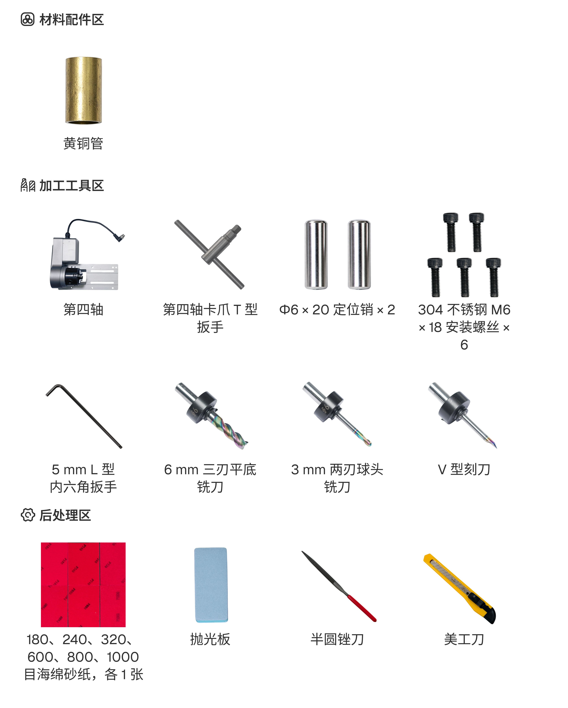

# 制作戒指

本案例使用 C500 的第四轴功能加工一枚戒指。

本案例重点介绍第四轴安装、圆柱材料装夹和四轴加工设置。设备连接、刀具读取及其他基础操作不再重复介绍。

## 材料与工具

准备下图所示的材料与工具。

{width=14cm}

## 加工流程

### 1. 第四轴安装

1. 将两根定位销装入工作台图示位置。
2. 将第四轴对准定位销放置在工作台上，使用 6 颗 M6 × 18 内六角螺钉固定。
3. 确认设备已断电，连接第四轴航空插头并拧紧锁固螺母。

> [!caution] 注意
> 第四轴不支持热插拔。严禁在设备通电状态下插拔航空插头。

> 待插入：定位销安装、第四轴固定及航空插头连接图。

### 2. 材料装夹

1. 使用配套扳手松开第四轴卡盘，将戒指毛坯装入卡盘并调整伸出位置。
2. 拧紧卡盘，确认毛坯夹持稳固。
3. 将顶针尾座移动至材料另一端，锁紧尾座并调整顶针，使材料获得稳定支撑。
4. 手动检查材料、卡盘和顶针的安装状态，确认转动范围内没有干涉。

> 待插入：毛坯放置、卡盘锁紧、尾座调整及装夹完成图。

### 3. 加工设置

1. 安装本案例使用的刀具，关闭防护门，并确认软件读取的刀具信息与实际安装一致。
2. 选择“四轴”加工模式，导入戒指模型。
3. 根据实际毛坯选择圆柱体材料，设置毛坯长度和直径。
4. 调整模型方向及对齐方式，确认模型位于毛坯范围内，并为卡盘夹持区域预留足够空间。
5. 设置本案例使用的刀具及加工参数，生成刀路并进入预览界面检查加工范围。

> 待插入：四轴模式、毛坯尺寸、模型方向、对齐方式、刀具参数及刀路预览界面。

### 4. 开始加工

1. 按照本案例的定位流程设置并检查工件坐标，确认加工位置正确。
2. 检查刀路范围与第四轴、卡盘及尾座之间是否存在碰撞风险。
3. 关闭防护门并开始加工，过程中持续观察设备运行状态。
4. 加工完成并确认设备停止后，松开顶针和卡盘，取出工件。
5. 按照成品要求完成分离、去毛刺、打磨和清洁。

> 待插入：工件定位、加工范围检查、加工过程、工件取出及后处理图。

## 成品展示

> **成品展示区**  
> 待插入：戒指整体、纹理细节、内外表面及佩戴效果图。

