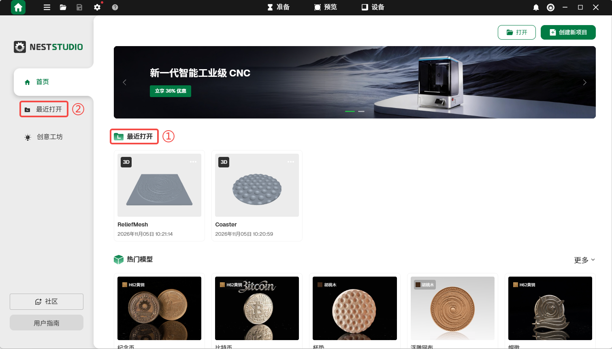
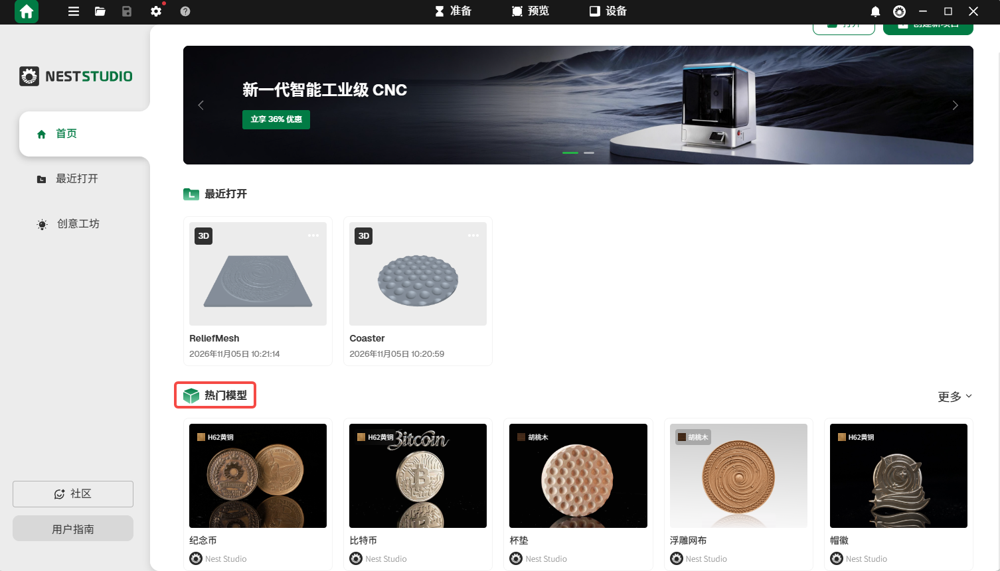
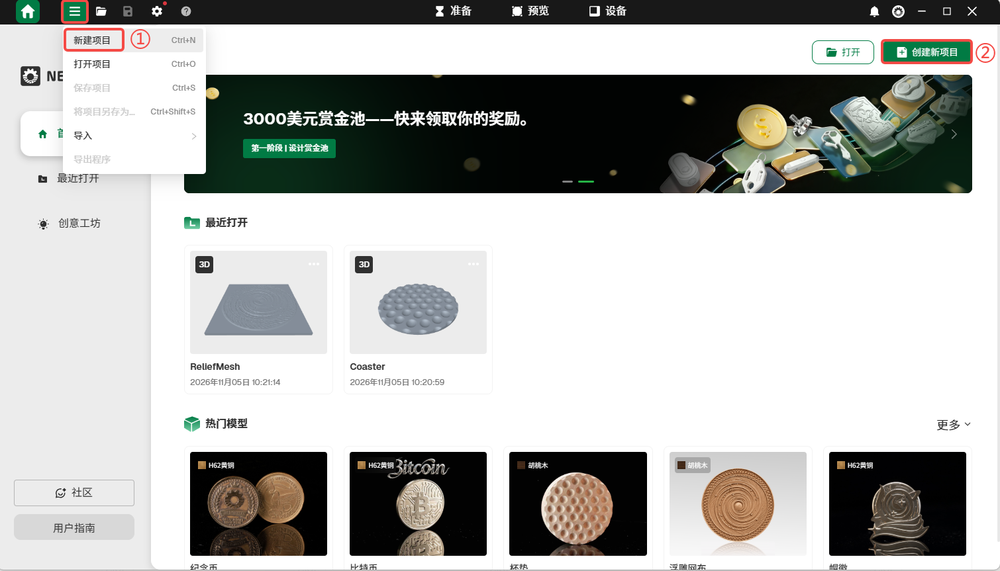
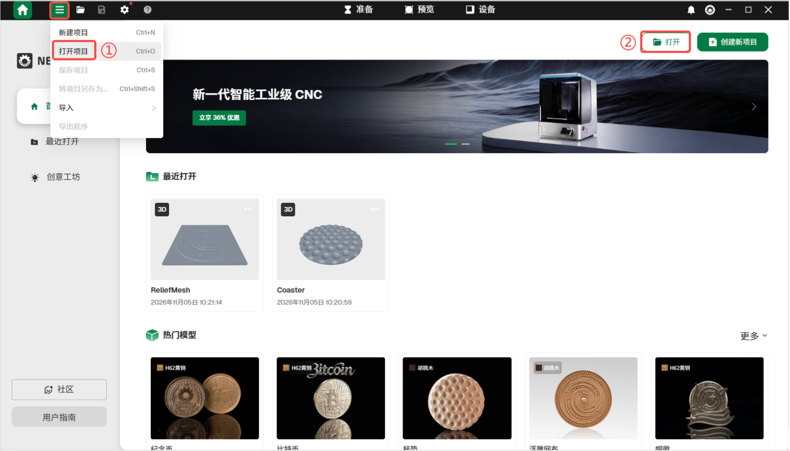
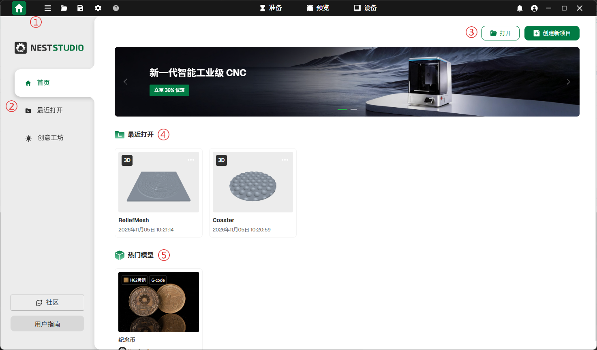

### 首页

**查看最近项目**  

快捷打开最近编辑或使用的项目文件。

<!-- publication-image: {width=12cm} -->

**查看热门模型**  

浏览热门模型，单击打开感兴趣的模型。

<!-- publication-image: {width=12cm} -->

**创建新项目**  

快速创建新的 NestStudio 项目。

<!-- publication-image: {width=12cm} -->

**打开本地文件**  

点击 **打开**，打开本地文件。支持所有 NestStudio 文件、3D 文件及 NestStudio 项目包。

<!-- publication-image: {width=12cm} -->

**主页界面布局**

<!-- publication-image: {width=12cm} -->

| **序号**  | **功能**       | **说明**                                     |
| :---      | :--------     | :--------------------------------------      |
| 1   | 主工具栏     | 包含 HOME、新建项目、导入图纸、导出程序、保存文件、急停、账号设置、设置 |
| 2   | 菜单栏      | 包含首页、最近打开文件、创意工坊、用户指南、社区    |
| 3   | 打开/创建新项目 | 打开本地文件或创建新项目                           |
| 4   | 最近打开     | 快速访问最近保存的文件                            |
| 5   | 热门模型     | 查看热门模型文件，并可直接打开                        |

