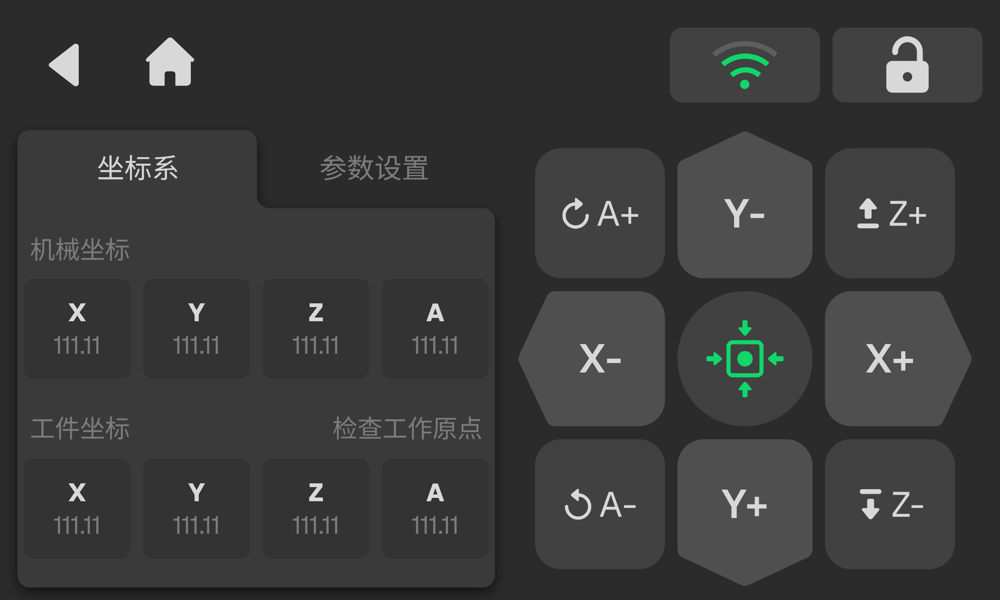

### 主轴运动面板

面板提供 X、Y、Z 轴的手动运动控制。用户可通过：

- 单击实现点动；
    
- 长按实现持续运动；
    
- 点击 **参数设置** 进入运动参数修改页面。
    

当安装第四轴扩展模块并被系统识别后，界面将提示“四轴已接入”，此时面板开放 A 轴手动控制。

<!-- publication-image: {width=12cm} -->

<!-- mdwb:figure id=e18aed79bf71e3bb -->
Figure 6-5 主轴运动面板
<!-- /mdwb:figure -->

