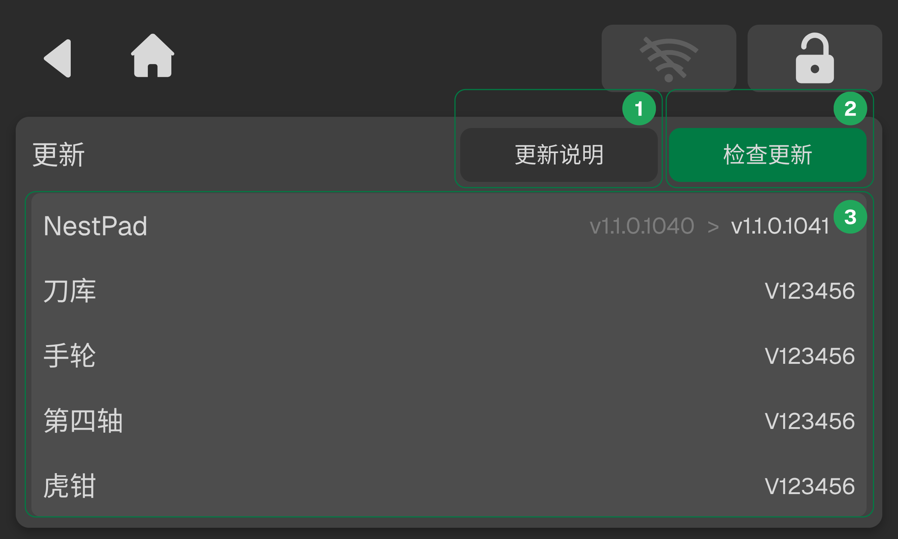

### 更新

更新页面可查看当前 NestPad 及配件的版本信息。当检测到新版本时，基础设置界面将高亮显示 “New” 标识。

点击 **更新说明**，查看更新项目详情。点击 **检查更新**，更新所有项目。

<!-- publication-image: {width=12cm} -->

| 序号  | 名称   | 说明                           |
| :--- | :---- | :---------------------------- |
| 1   | 更新说明 | 查看当前版本的更新说明，包括新增功能、问题修复等              |
| 2   | 检查更新 | 一键检测 NestPad 软件与各配件固件是否需要更新 |
| 3   | 版本列表 | 显示各模块当前版本号，包括 NestPad 软件及已接入的配件（如刀库、手轮、第四轴、虎钳等） |

> [!caution] 注意
> 更新过程中，系统将自动下载并安装更新包。更新期间请勿关闭设备或断开电源。

