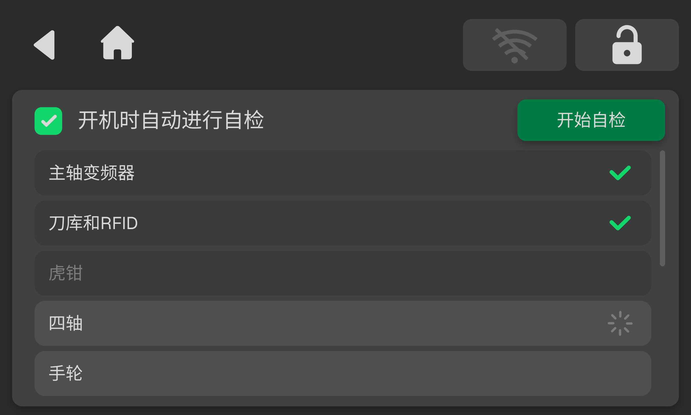
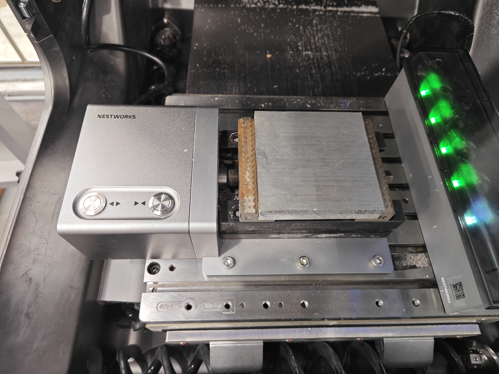
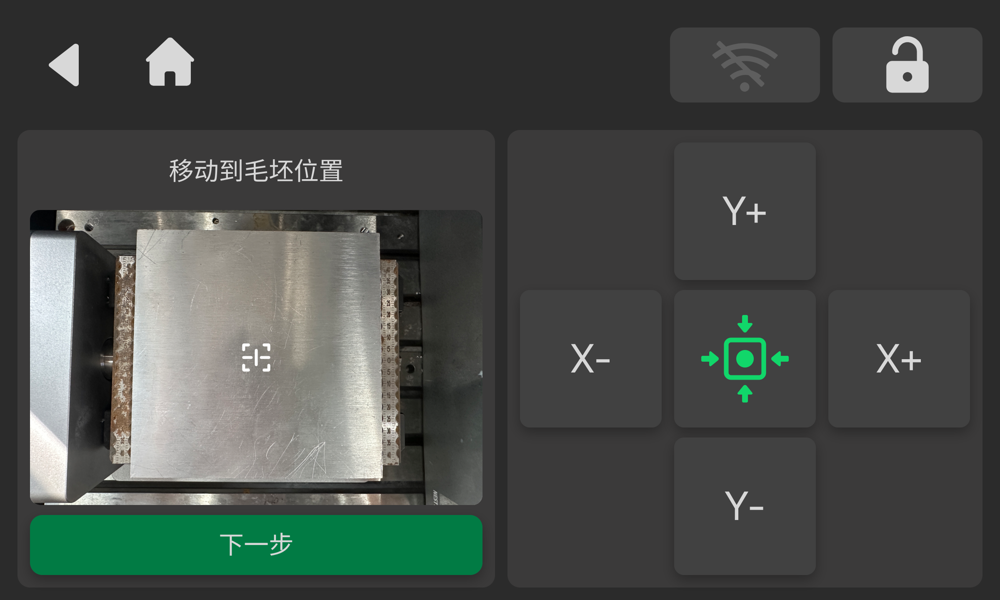
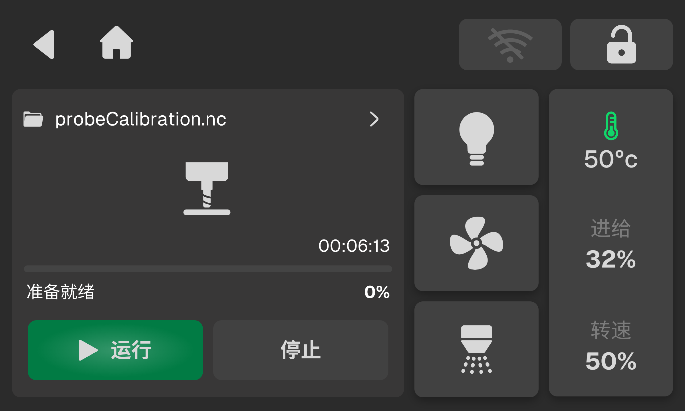
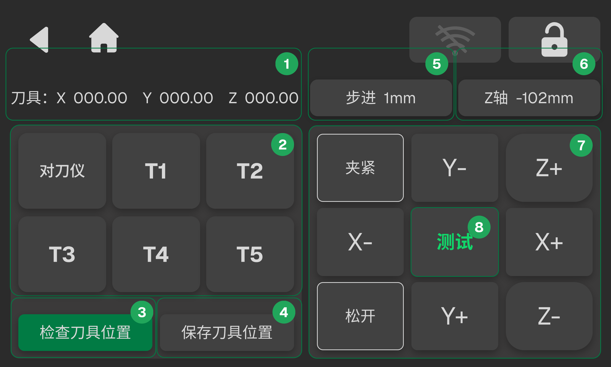
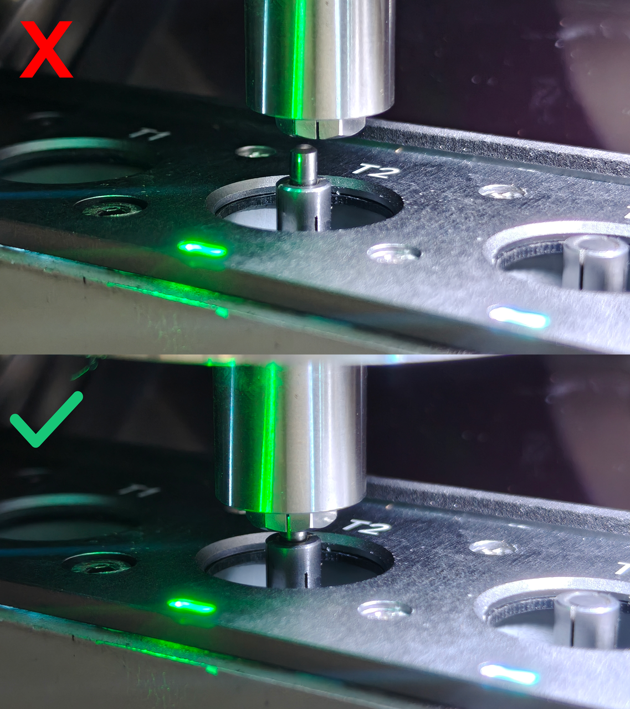
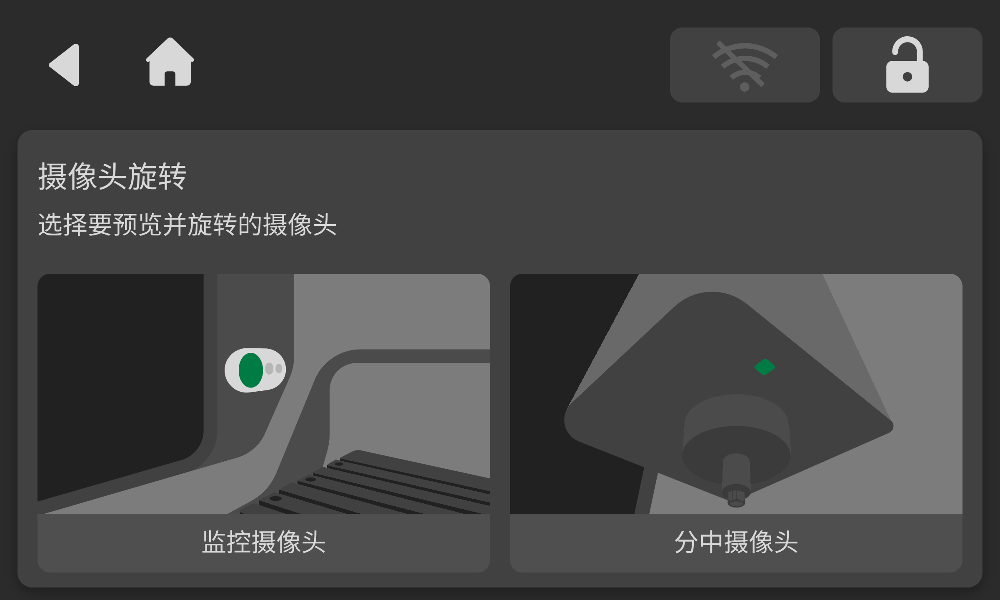
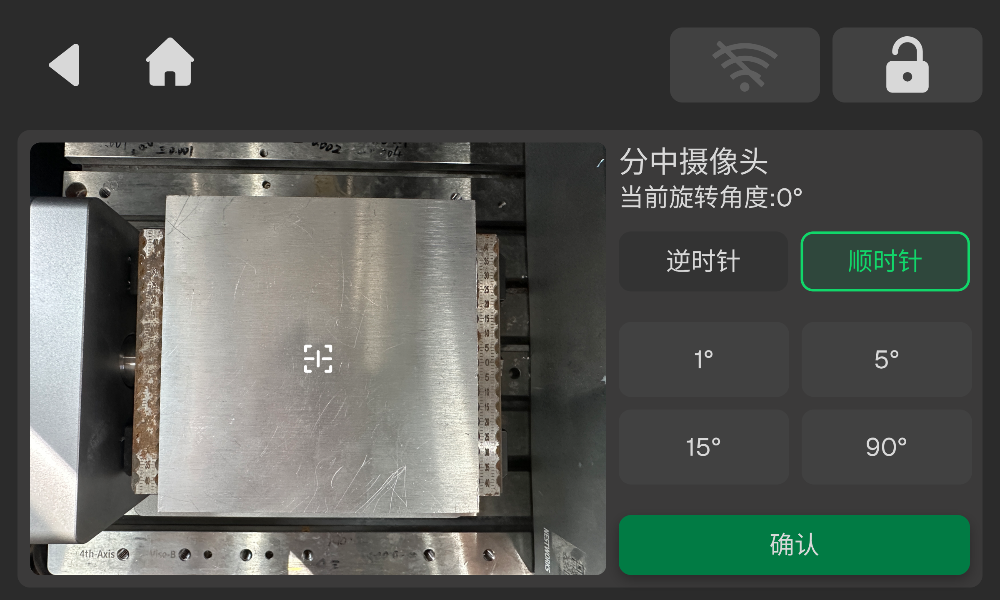
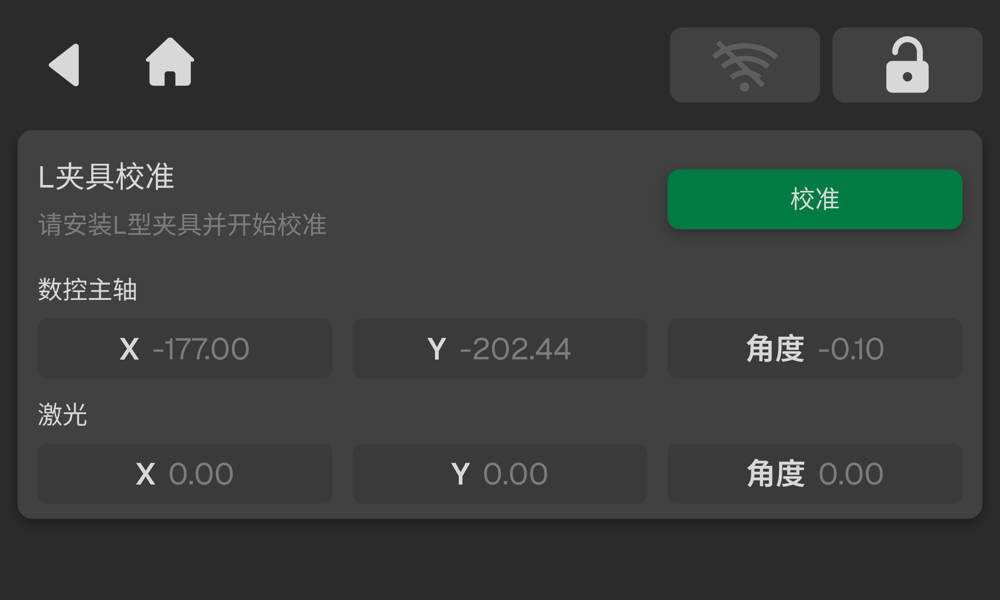
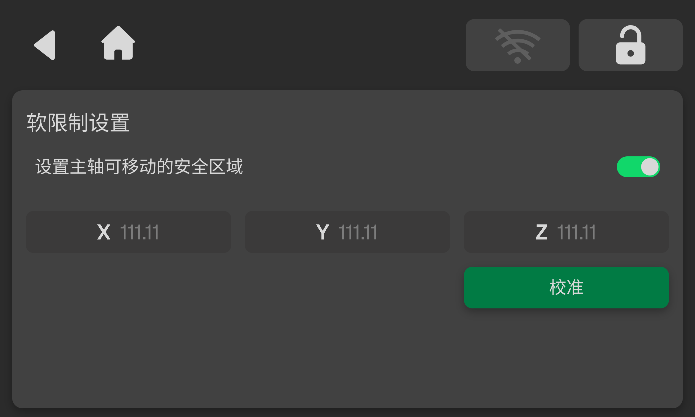

### 校准与工具

校准与工具页面提供设备自检及设置设备的工具类功能。

#### 开机自检

开启该功能后，设备上电时将自动启动自检；也可在当前页面点击 **开始诊断**，手动触发检测，以核查各功能模块的通信状态是否正常。

<!-- publication-image: {width=12cm} -->

#### 探针控制

探针校准用于手动控制探针伸出与收回。点击 **下移** 伸出探针，点击 **上移** 收回探针。

#### 探针校准

探针校准用于修正探针在 X、Y、Z 方向上的偏移量，帮助提高自动分中和定位的准确性。校准过程包含实际切削，请按以下要求准备工件和刀具，并依照界面提示完成操作。

> [!danger] 危险
> 
> - 校准过程中，请勿触碰工件或探针，不得将手或工具伸入运动区域。
>     
> - 加工期间不得打开防护门或触碰设备运动部件。
>     

> [!caution] 注意
> 
> - 校准过程中设备会切削工件。开始前请确认毛坯装夹牢固、刀具安装正确，且加工区域内无异物。
>     
> - 探针校准过程中禁止回零，以防零位偏差，导致校准误差。
>     
> - 如发生异常、断电或流程中断，请停止操作并按本指南的异常处理说明重新开始。
> 

**工具和材料**
- 校准用铝制毛坯（尺寸不小于 50 * 50 * 20 mm）
- 6 mm平铣刀（安装在 T1 刀位）
- 软毛刷或吸尘器（用于清除工件凹槽及探针周围的切屑及粉尘）

**校准步骤**

1. 将铝制校准毛坯（尺寸不小于 50 * 50 * 20 mm）装夹在工作台上并确认牢固，确认 T1 刀位装有与校准程序匹配的 6 mm平铣刀。
<!-- publication-image: {width=12cm} -->

2. 点击 **首页 > 设置 > 校准工具 > 探针校准**，进入探针校准页面，检查界面提示及设备状态，确认后点击 **开始校准** 。
<!-- publication-image: {width=12cm} -->

3. 完成校准后，系统跳转到自动分中界面。根据自动分中界面操作说明进行操作。
<!-- publication-image: {width=12cm} -->

4. 完成自动分中后，系统会跳转到加工页面，再次确认工件、刀具和防护门状态。关闭防护门并点击 **运行** ，等待校准凹槽加工完成。
<!-- publication-image: {width=12cm} -->

5. 加工完成后，系统返回校准页面并提示清理切屑。待设备停止后，按设备安全操作要求打开防护门，使用软毛刷或吸尘器清理凹槽内的切屑。清理时保持工件和夹具位置不变；清理完成后关闭防护门，再点击 **继续** 。
<!-- publication-image: {width=12cm} -->

6. 系统将自动伸出探针，对凹槽底部及周边进行测量并复测校准结果。过程中无需手动移动设备，且不得触碰工件或探针。

7. 出现“探针校准成功”提示后，点击 **确定** 。系统会自动写入校准值，无需手动填写。

**日常清洁**

每次校准前后检查探针及周边是否附着切屑、粉尘或油污；加工结束后及时清理，发现污染时也应清洁后再进行测量。

如发现探针弯曲、松动、破损或动作异常，请停止使用并联系技术支持，不得自行拆解或调整探针机构。

**异常处理**

| 异常情况        | 处理说明                                         |
| :-------------- | :------------------------------------------------  |
| 校准失败 | 根据界面提示清除凹槽内切屑。 若工件和夹具位置未改变、且界面允许重新探测时，可点击 **重新探测**； 若工件移动或装夹更换，应重新点击 **开始校准**，执行完整校准流程。|
| 加工完成后未返回校准页面 | 手动进入校准页面后，系统会弹窗提示清理凹槽内的切屑，可根据提示进入后续校准流程。 若误点击 **取消**，在工件和夹具未移动且界面仍提供重新探测功能时，可按提示继续；否则重新开始校准。|
| 流程中断或设备断电 | 若断电发生在校准过程中，则流程需重新进行； 若断电发生在加工前，则流程需要重新进行； 若断电发生在凹槽加工过程中或探针探测过程中，则需要重新更换物料进行加工。  |
| 出现碰撞风险、探针异常或设备报警 | 立即停止操作，排除风险并按设备提示处理，不得在探针、工件或夹具位置异常时继续校准。  |
| 校准过程中按下急停按钮 | 按下急停后，所有轴立即停止，坐标基准将丢失，本次校准数据失效，无法继续校准。请解除急停并复位，执行回零重建坐标基准后，重新点击 **开始校准**，执行完整校准流程。  |

#### 刀库门角度复位
该功能用于校正刀库门的角度基准。当系统识别刀库门角度异常，或开关动作不正常时，可通过执行此复位操作，让系统重新标定刀库门的开合角度，从而保障开关逻辑正常。

**操作前提**

执行复位前，请务必确认刀库门运动范围内无异物阻挡。

**操作步骤**

确认安全后，点击 **首页 > 设置 > 校准工具 > 刀库门角度复位**，进入刀库门角度复位页面。点击 **复位**，完成角度标定。

<!-- publication-image: {width=12cm} -->

#### 刀库校准

<!-- publication-image: {width=12cm} -->

| 序号  | 名称    | 说明                                              |
| :--- | :----- | :----------------------------------------------- |
| 1   | 坐标信息  | 显示当前选中刀具或对刀仪的 X、Y、Z 坐标。                          |
| 2   | 刀号    | 显示对刀仪及各刀号。选中后，上方坐标信息将同步更新。                       |
| 3   | 检查刀具位置  | 选中刀具或对刀仪后点击按钮，主轴将移动至对应刀具或对刀仪的正上方，以检查刀具或对刀仪位置。    |
| 4   | 保存刀具位置  | 将当前主轴坐标保存并更新为所选刀具或对刀仪的坐标。                        |
| 5   | 运动步进量 | 设置主轴每次点击的移动距离、步进量。                               |
| 6   | Z 轴高度设置 | 设置取刀时的固定 Z轴高度。                               |
| 7   | 运动面板  | 支持主轴沿 X、Y、Z 轴运动。可通过 **夹紧** 和 **松开** 按钮控制夹头。     |
| 8   | 测试按钮  | 点击 **测试** ，根据当前选中的刀具或对刀仪执行取刀或对刀操作，用于验证当前位置是否准确。 |

**校准步骤**
1. 选中左侧任意刀位，点击 **检查刀具位置**。刀库盖子打开后，主轴将移动至对应刀具上方，目视检查主轴与刀具是否对齐。
2. 通过右侧运动面板控制主轴移动，调整主轴位置。确认主轴与刀具对齐后，点击 **保存刀具位置**，保存并更新当前刀位坐标。
3. 确认主轴与刀具对齐后，点击 **测试**，验证取刀/放刀动作是否正常、位置是否准确。确认无误后，在校准完成界面中点击 **确认**，保存并更新当前刀位坐标。
<!-- publication-image: {width=10cm} -->

> [!caution] 注意  
> - 主轴需要尽量对齐刀具。进行此操作时，建议将步进量设置为 0.1 或 0.01 进行微量移动，防止因误触导致碰撞。
> - 对刀仪校准前，主轴必须预先装好刀具，否则将无法完成对刀仪校准。

#### 摄像头旋转

摄像头旋转用于校正摄像头物理安装带来的画面方向偏差，统一视觉图像坐标系，保证监控画面、分中、视觉检测、二维码识别等所有视觉功能的坐标计算与识别结果准确无误。

设备支持对分中摄像头和监控摄像头分别独立设置旋转参数。

**操作步骤**
1. 点击 **设置 > 校准工具 > 摄像头旋转**，进入摄像头旋转页面，点击选择 **监控摄像头** 或 **分中摄像头**，进入对应的预览调节界面。
<!-- publication-image: {width=10cm} -->

2. 预览并调节画面方向，左侧为实时画面预览区，右侧显示当前摄像头的旋转角度。
   - 旋转方向：点击 **顺时针** 或 **逆时针**，控制画面旋转。
   - 调节旋转步长：可选 1°、5°、15°、90°，点击步长按钮切换单次旋转增量。
   - 画面实时跟随旋转，角度数值同步更新。
<!-- publication-image: {width=10cm} -->

3. 将画面调整至和机床物理方向一致后，点击 **确认** 保存参数。参数将持久化存储，重启设备后依然生效。

> [!note] 提示
> - 两个摄像头参数相互独立，设置其中一个不会影响另一个。
> - 更换、拆装摄像头或重装设备后，建议重新核对并校正摄像头旋转方向。
> - 所有视觉相关功能（分中、目标检测、二维码识别等）均会读取该旋转参数，若参数错误，会直接导致视觉定位与识别出错。

#### L 型夹具校准

L 型夹具校准用于对安装在工作台的 L 型定位夹具执行自动化基准探测与坐标校准，通过探针采集夹具基准点位，自动识别夹具的安装模式（CNC/激光），解算夹具角点坐标与倾斜角度，校准结果为后续 L 型夹具分中提供基准数据，保障工件零点定位精度，减少人工对刀误差。

**校准前准备**
| 检查项       | 说明                                     |
| :-------- | :-------------------------------------- |
| 机床状态    | 确认机床已完成回零操作，各轴运动正常，无报警残留。 |
| 探针      | 确认探针已正确安装、连接可靠，探针无损坏。    |
| 夹具装夹 | 确认 L 型定位夹具已牢固装夹在工作台指定位置，且处于系统可识别的探测范围内。                           |
| 通信连接     | 确认机床控制器与系统通信正常，无断线、干扰。                            |
| 作业区域     | 确认机床运动范围内无多余工件、工具及杂物。                        |
| 急停装置     | 确认机床急停开关功能正常，异常时可随时触发。                        |

以上条件确认无误后，方可执行 L 型夹具校准。

**操作步骤**
1. 将 L 型夹具固定在工作台指定位置，确保装夹牢固。

2. 点击 **首页 > 设置 > 校准工具 > L 型夹具校准**，进入 L 型夹具校准页面，点击 **校准**，系统进入自动执行流程。
<!-- publication-image: {width=10cm} -->

3. 探针依次完成工作台 Z 面高度探测、X 轴巡边、Y 轴巡边，采集夹具基准点位并自动判定夹具安装模式。点位采集完成后收回探针，主轴回到安全高度。
   > [!caution] 注意
   > 
   > 若主轴上装有刀具，则先执行还刀归位，规避刀探碰撞风险。随后主轴抬升至安全高度，移动至预设探测起点，伸出探针准备探测。

4. 弹窗提示“校准完成”时，点击 **确定**，系统自动保存并写入夹具 X 坐标、Y 坐标与倾斜角度参数。
   > [!caution] 注意
   > 
   > - 首次安装、拆卸重装、挪动 L 型夹具位置后，必须重新执行 L 型夹具校准。
   > - 校准全程为自动运动，过程中禁止移动夹具、触碰探针，避免探测失效或发生碰撞。
   > - 校准过程中遇到报警、异常情况或主动停止后，需排查故障、确认设备安全，方可重新启动校准。

   > [!note] 提示
   > 
   > 校准参数自动保存，可直接查看 CNC 模式、激光模式下对应的夹具标定数据。

#### 软限位设置

软限位用于限定主轴安全运行行程，在硬限位触发前提前限制轴运动范围，作为前置安全保护，降低撞机风险，保护丝杆、刀具与工件。每台设备装配存在个体误差，调机、拆装主轴或发生碰撞后，均需重新校准软限位。

开启 **软限制设置**，主轴超出设定行程将触发报警并限制运动；关闭后仅保留硬限位一级保护，仅用于极限行程测试，正常加工务必开启。

**校准前准备**

执行校准前，请确认满足以下条件：
- 主轴已卸下刀具。
- 工作台无安装第四轴、虎钳或工件（刀库可保持安装状态）。
- 加工区域无遮挡，无干涉风险。
- 设备零位正常；若系统检测零位存在偏差，请先执行回零。

**操作步骤**

1. 点击 **首页 > 设置 > 校准工具 > 软限位设置**，进入软限位设置页面，点击 **校准**，系统进入自动校准流程。
<!-- publication-image: {width=10cm} -->

2. 校准启动后，主轴将依次向 X 轴左侧、Y 轴后方、Z 轴下方硬限位方向移动。触碰硬限位后反向回弹 1mm，并记录该位置作为对应轴软限位边界。
3. 三轴采集完成后设备自动回零，界面提示“软限位校准完成”，并自动保存 X、Y、Z 三轴软限位参数。

   > [!caution] 注意
   > 
   > 校准过程中请勿触碰主轴、断电或强制停止设备。
    

   > [!note] 提示
   > 
   > 拆装主轴、重新调机、发生碰撞后，建议重新执行软限位校准。

