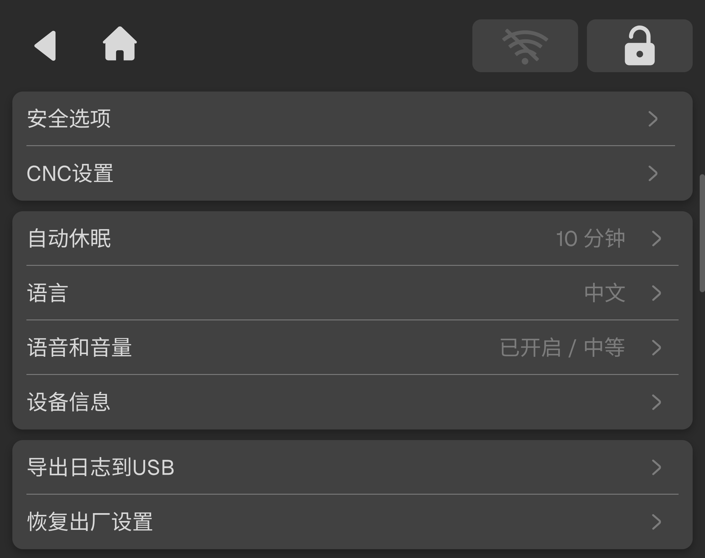

### 偏好设置

偏好设置页面提供多项设备功能与系统参数配置，用户可根据实际使用需求进行个性化设置。

<!-- publication-image: {width=12cm} -->

| 名称         | 说明                                   |
| :---------- | :------------------------------------ |
| **安全选项**   | 用于设置与设备使用安全相关的功能选项。                  |
| **CNC 设置** | 用于设置加工相关的偏好选项，如单位、自动休眠等。             |
| **自动休眠**   | 支持设置 NestPad 屏幕的睡眠时长（可选 2分钟、5分钟、10分钟），可选择关闭睡眠模式。                |
| **语言**   | 切换系统界面显示语言，支持中英文等语言显示。               |
| **语音和音量**  | 开启或关闭设备音效及语音播报功能。                    |
| **设备信息**   | 查看和管理设备信息，包括修改设备昵称、查看设备使用时长及设备唯一序列号。 |
| **导出日志到USB**   | 将设备运行日志导出至 U 盘，便于技术人员进行问题排查。         |
| **恢复出厂设置**   | 清除所有偏好设置与本地数据，将设备恢复至出厂状态。操作不可撤销，建议先备份文件并导出日志。        |
